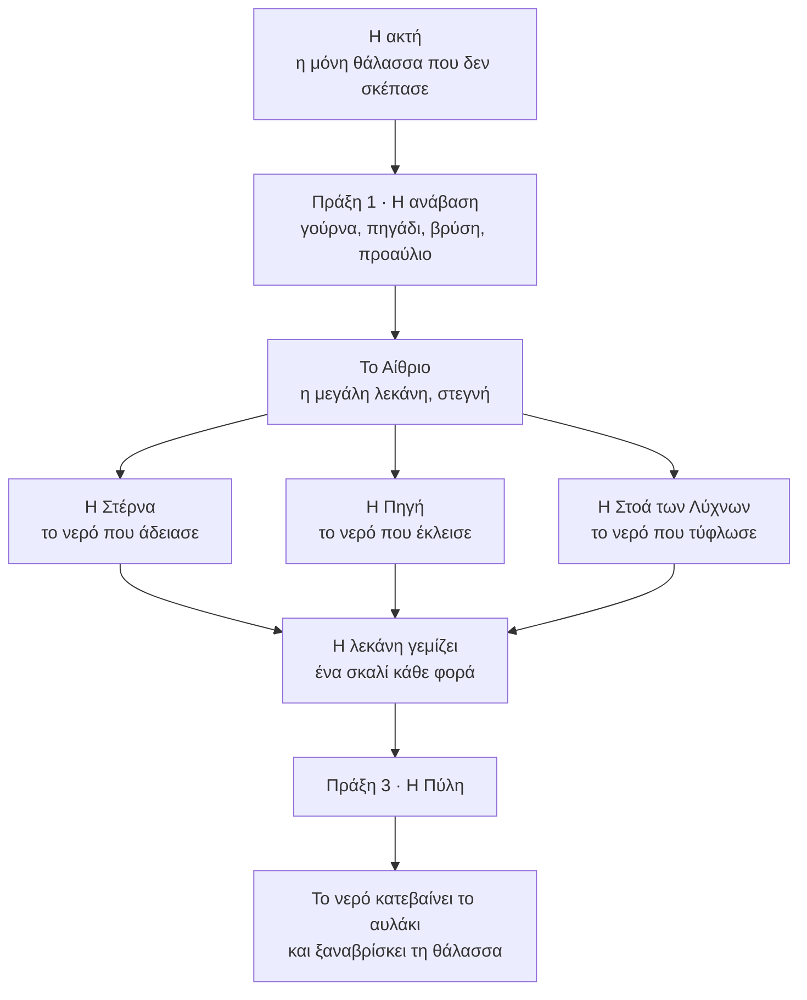

# EIDOLON · Κεφάλαιο 1: Η Πύλη με το Πέπλο

*Το flow του κεφαλαίου, δεύτερη γραφή: ένα σπίτι, ένα αυλάκι, καμία αυλή του demo όπως είναι. Αντικαθιστά το `CH1_V3.md` ως σχέδιο προς χτίσιμο, αν εγκριθεί. Οι αριθμοί «αρ.» παραπέμπουν στο `EIDOLON_PUZZLES_ALL.md`.*

Το κεφάλαιο 1 γραμμένο ως ένα πράγμα, χωρίς καμία αυλή του demo όπως είναι. Ένα σπίτι, ένα αυλάκι που το διασχίζει από την κορυφή ως τη θάλασσα, και ένας άνθρωπος που έδιωξε το νερό για να μην υπάρχει καθρέφτης. 20 γρίφοι, κύριος δρόμος 2 ώρες και 45 λεπτά, με τα προαιρετικά 3 ώρες και 15.

## Με μια ματιά

- **Ο άξονας.** Εκείνος έκρυψε κάθε καθρέφτη. Το νερό όμως είναι κι αυτό καθρέφτης, οπότε το έδιωξε από το σπίτι: έκλεισε την πηγή, άδειασε τη στέρνα, τύφλωσε το κανάλι με φως, στέγνωσε τη μεγάλη λεκάνη. Όλο το κεφάλαιο είναι μία πράξη: φέρνεις το νερό πίσω.
- **Ο τόπος.** Το σπίτι ανεβαίνει από τη θάλασσα σε πεζούλια. Ένα μαρμάρινο αυλάκι με σκαλιά το διασχίζει από πάνω ως κάτω. Ο δρόμος της είναι το ίδιο το ξερό αυλάκι και οι πόρτες της είναι οι φράκτες του.
- **Ο στόχος.** Στην κορυφή, μια πύλη σκεπασμένη με ένα μεγάλο πανί. Φαίνεται από την ακτή, στο πρώτο λεπτό.
- **Η σειρά.** Πράξη 1: ανεβαίνει από τη θάλασσα ως το αίθριο, περνώντας από τα λίγα νερά που του ξέφυγαν (30 λεπτά). Πράξη 2: τρεις πτέρυγες με όποια σειρά, μία για κάθε τρόπο που έδιωξε το νερό (90 λεπτά). Πράξη 3: η Πύλη (30 λεπτά). Η τελευταία εικόνα είναι το νερό που κατεβαίνει όλο το αυλάκι και ξαναβρίσκει τη θάλασσα.
- **Το demo.** Καμία από τις τέσσερις αυλές του δεν μπαίνει όπως είναι. Μένουν τα συστήματα: το πάτημα, η αντανάκλαση, η στάση, η τσέπη, οι στήλες, τα χρυσά χέρια, οι λύχνοι.

## Οι έξι κανόνες

| | Κανόνας | Τι λέει | Πού παίζεται |
|---|---|---|---|
| Κ1 | Το νερό κρατά ό,τι εκείνος έκρυψε | Όπου πάνω και κάτω διαφωνούν, δίκιο έχει το νερό. | ακτή, βρύση, προαύλιο, Πύλη, οκτώ καμάρες |
| Κ2 | Δεύτερο σώμα | Πατάς το νερό και η αντανάκλαση πηγαίνει εκεί, αν έχει πού να πατήσει. Ξεκινά πάντα από εκεί που στέκεται εκείνη. | παντού |
| Κ3 | Η επιφάνεια είναι πόρτα | Ό,τι αγγίξει το ακίνητο νερό γίνεται ένα με το είδωλό του. Τα πράγματα περνούν από χέρι σε χέρι. | πηγάδι, Στέρνα, Μεγάλος Λύχνος, Πύλη |
| Κ4 | Στάση | Σε άδειο βάθρο γίνεται άγαλμα, και ό,τι μετρά αγάλματα τη μετρά. Όσο είναι άγαλμα, δεν κουνιέται. | προαύλιο, Πηγή, Πύλη |
| Κ5 | Ύψος και στάθμη | Όσο ψηλά στέκεται εκείνη, τόσο βαθιά στέκεται η αντανάκλαση. Ένα σκαλί νερό ανεβάζει τον κόσμο του δύο σκαλιά. | Στέρνα, αίθριο |
| Κ6 | Το φως τυφλώνει το νερό | Όπου πέφτει η λάμψη μιας φλόγας, το νερό παύει να είναι καθρέφτης. | Στοά των Λύχνων, Πύλη |

## Ο χάρτης

## Πόσο κρατά

| Μέρος | Τι έχει | Λεπτά |
|---|---|---:|
| Πράξη 1 · Η ανάβαση | 5 γρίφοι, ένα πέρασμα, το αίθριο | 30 |
| Η Στέρνα | 4 γρίφοι και ένα πέρασμα | 28 |
| Η Πηγή | 4 γρίφοι και ένα πέρασμα | 31 |
| Η Στοά των Λύχνων | 4 γρίφοι και ένα πέρασμα | 29 |
| Το αίθριο ανάμεσα | τρία νερά, δρόμοι επιστροφής | 17 |
| Πράξη 3 · Η Πύλη | 3 γρίφοι και δύο θεάματα | 30 |
| **Κύριος δρόμος** | 20 γρίφοι | **165** (2 ώ 45′) |
| Ονόματα, ενθύμια, μισά σκαλίσματα, στήλες | προαιρετικά | 30 |
| **Με όλα** | | **195** (3 ώ 15′) |

## Πράξη 1 · Η ανάβαση (30′)

Γραμμική. Ανεβαίνει μέσα στο ξερό αυλάκι, από φράκτη σε φράκτη. Μέσα στο σπίτι έχουν μείνει μόνο τα νερά που του ξέφυγαν, το καθένα λίγο μεγαλύτερο από το προηγούμενο, και το καθένα μαθαίνει ένα ρήμα.

### I.1 · Η ακτή

*γρίφος · 6′ · ο βασικός κανόνας, στημένος στη θάλασσα*

Η ίδια ακίνητη θάλασσα με την οποία τελειώνει το intro. Στην άκρη του μόλου ένα βάθρο, κι εκείνη όρθια πάνω του, γυρισμένη προς το πέλαγος. Πίσω της το σπίτι ανεβαίνει σε πεζούλια, και στην κορυφή του φαίνεται μια πύλη σκεπασμένη με πανί. Ο μόλος είναι σπασμένος στη μέση: ο τροχός του πρώτου φράκτη έχει μείνει στο κομμένο κομμάτι, στα ανοιχτά.

1. Το πρώτο πάτημα την κατεβάζει από το βάθρο. Στο νερό το είδωλό της κατεβαίνει μισή στιγμή αργότερα.
2. Ο φράκτης στο πόδι του αυλακιού είναι κλειστός και ο τροχός του απέναντι, πέρα από το σπάσιμο.
3. Πατά τη θάλασσα: η αντανάκλαση βγαίνει από τα πόδια της. Στο νερό ο μόλος είναι ακέραιος.
4. Τον περπατά ως την άκρη, γυρίζει τον τροχό, ο φράκτης ανοίγει.

- **Η παγίδα:** Πάνω ο δρόμος τελειώνει στο σπάσιμο.
- **Το «αχά»:** «Στο νερό ο μόλος είναι ολόκληρος, κι εκείνη τον περπατά.»
- **Τι αφήνει:** Το ρήμα «πάτα το νερό» (Κ2) και την πρώτη εικόνα του Κ1. Από εδώ και πάνω το σπίτι δεν έχει καθρέφτη, και το νιώθεις.
- **Η στήλη του:** `the sea i could not cover`

### I.2 · Το ξερό αυλάκι

*πέρασμα · 2′ · δικό του*

Ανεβαίνει μέσα στην κοίτη του αυλακιού, σκαλί σκαλί. Στα πεζούλια δεξιά κι αριστερά, καθρέφτες γυρισμένοι στον τοίχο και βιδωμένοι. Σε ένα μέτωπο σκαλιού, στην παλιά γραμμή του νερού, ένα σκάλισμα κομμένο στη μέση. Πατά την κοίτη: εκείνη σκύβει, δεν υπάρχει τίποτα να δει.

- **Τι αφήνει:** Το πρώτο μισό σκάλισμα, που θα ολοκληρωθεί μόνο στην τελευταία εικόνα του κεφαλαίου.
- **Η στήλη του:** `so i turned the water away from the house`

### I.3 · Η γούρνα

*γρίφος · 5′ · αρ. 10*

Ένα στενό πέρασμα ανάμεσα σε δύο τοίχους. Κατά μήκος του μια πέτρινη γούρνα με βροχόνερο: το πρώτο νερό μέσα στο σπίτι. Ο φράκτης είναι στο βάθος, πίσω από μια σιδεριά, και ο τροχός του πίσω της. Στο νερό της γούρνας φαίνεται μια άλλη σιδεριά, στη μέση του περάσματος, που πάνω δεν υπάρχει.

1. Από την είσοδο στέλνει την αντανάκλαση: σταματά στη σιδεριά που υπάρχει μόνο στο νερό.
2. Εκείνη προχωρά πάνω, όπου η μεσαία σιδεριά δεν υπάρχει, ως τη μία πλάκα ανάμεσα στις δύο.
3. Από εκεί τη στέλνει ξανά: η αντανάκλαση ξεκινά από τα πόδια της, ήδη πέρα από τη δική της σιδεριά, και περνά κάτω από τη σιδεριά εκείνης.
4. Γυρίζει τον τροχό από πίσω. Σιδεριά και φράκτης σηκώνονται.

- **Η παγίδα:** Η αντανάκλαση σταματά εκεί που εκείνη περνά, κι εκείνη εκεί που περνά η αντανάκλαση.
- **Το «αχά»:** «Ξεκινά από εκεί που στέκομαι. Τον μισό δρόμο τον κάνω εγώ για εκείνη.»
- **Τι αφήνει:** Την ερώτηση κάθε επόμενης αυλής: από πού τη στέλνω;
- **Η στήλη του:** `rain. i cannot forbid the rain`

### I.4 · Το πηγάδι

*γρίφος · 4′ · αρ. 11*

Μια μικρή αυλή με ένα πηγάδι και το μαγκάνι του. Ο φράκτης εδώ δεν έχει μανιβέλα: η υποδοχή της είναι άδεια. Ο κουβάς κρέμεται άδειος πάνω από το στόμιο. Στο νερό του πηγαδιού, ο ίδιος κουβάς έχει μέσα τη μανιβέλα.

1. Πατά το νερό: το πηγάδι είναι στενό και η αντανάκλαση δεν έχει πού να πατήσει.
2. Γυρίζει το μαγκάνι. Ο άδειος κουβάς κατεβαίνει ώσπου να αγγίξει την επιφάνεια.
3. Κουβάς και είδωλο γίνονται ένα. Τον ανεβάζει, και μέσα του είναι η μανιβέλα, βρεγμένη.
4. Τη βάζει στον φράκτη και τον ανοίγει.

- **Η παγίδα:** Κανείς δεν χρειάζεται να πάει πουθενά.
- **Το «αχά»:** «Ό,τι αγγίξει το ακίνητο νερό συναντά το είδωλό του.»
- **Τι αφήνει:** Τον κανόνα Κ3. Ο κουβάς ξαναγυρίζει ως γάντζος στη Στέρνα και ως λύχνος στη Στοά.
- **Η στήλη του:** `i threw the handle down the well. the well kept it`

### I.5 · Η βρύση

*γρίφος · 4′ · αρ. 30 (πρώτο μισό) και αρ. 97*

Αυλή χωρίς έξοδο: εδώ το αυλάκι χάνεται μέσα σε έναν σκέτο τοίχο. Μπροστά του η λεκάνη μιας βρύσης, με μια παλάμη νερό ακόμη. Στο νερό ο τοίχος έχει μια καμάρα, και το αυλάκι περνά από μέσα της.

1. Στέλνει την αντανάκλαση: περνά την καμάρα του νερού, στέκεται από την άλλη μεριά και την περιμένει.
2. Πατά τον τοίχο πάνω: εκείνη τον σπρώχνει με τις δύο παλάμες.
3. Ο σοβάς ραγίζει και πέφτει. Από κάτω, η καμάρα.

- **Η παγίδα:** Είναι η πρώτη φορά που η αντανάκλαση δεν είναι η λύση.
- **Το «αχά»:** «Το νερό δεν δείχνει μόνο ό,τι μου λείπει. Δείχνει και ό,τι εκείνος έκρυψε.»
- **Τι αφήνει:** Το Κ1 ολόκληρο. Το ρήγμα δίπλα στην Πύλη, στο τέλος, είναι το ίδιο μάθημα.
- **Η στήλη του:** `i built that wall in one night. the water has not learned it`

### I.6 · Η θέση της

*γρίφος · 5′ · η ιδέα του «γίνε το άγαλμα», δεμένη με το Κ1*

Το προαύλιο του αιθρίου. Μια ρηχή, μακρόστενη λίμνη, το μεγαλύτερο νερό ως τώρα, και στις δύο πλευρές της από μια σειρά βάθρων με αγάλματά της. Η μεγάλη θύρα ανοίγει μόνο όταν οι σειρές είναι πλήρεις. Πάνω ένα βάθρο είναι άδειο. Στο νερό κανένα δεν είναι άδειο: στη θέση εκείνη στέκεται ένα άγαλμα.

1. Στέλνει την αντανάκλαση: πηγαίνει ως το άγαλμα του νερού, το κοιτά, και γυρίζει να κοιτάξει εκείνη.
2. Ανεβαίνει η ίδια στο άδειο βάθρο και παίρνει τη στάση που έχει το άγαλμα του νερού.
3. Η θύρα ανοίγει και μένει ανοιχτή.

- **Η παγίδα:** Ψάχνεις ποιο άγαλμα λείπει. Το νερό λέει ότι δεν λείπει κανένα.
- **Το «αχά»:** «Η θέση είναι δική μου. Η πόρτα με μετρά για άγαλμα.»
- **Τι αφήνει:** Το ρήμα «στάση» (Κ4). Ο ίδιος μηχανισμός, σε μεγάλο και γυρισμένος ανάποδα, είναι ο τελικός.
- **Η στήλη του:** `i left one place empty. i knew who it was for`

### I.7 · Το Αίθριο

*θέαμα · 4′ · δικό του*

Βγαίνει σε ένα μεγάλο αίθριο. Στη μέση, μια στρογγυλή λεκάνη τρία σκαλιά βαθιά, στεγνή: εδώ κατέληγαν και τα τρία νερά του σπιτιού, πριν κατέβουν το αυλάκι. Τρία αυλάκια έρχονται από τρεις πτέρυγες, στεγνά. Στο βόρειο χείλος, στην κορυφή μιας σκάλας, η Πύλη με το πανί. Δεξιά κι αριστερά της δύο λύχνοι καίνε μέρα μεσημέρι.

1. Πατά τη λεκάνη: εκείνη σκύβει και κοιτά. Δεν υπάρχει νερό, άρα δεν υπάρχει κανείς.
2. Ανεβαίνει ως την Πύλη: αμπαρωμένη, σκεπασμένη, δεμένη από πίσω.
3. Τρεις δρόμοι ανοίγουν.

- **Τι αφήνει:** Το θέλημα του κεφαλαίου χωρίς μία λέξη, και τη φράση που είναι ο τελικός γρίφος: «tied on the far side».
- **Η στήλη του:** `this one i could not turn, or sink, or blind. so i covered it`

- Ενθύμιο: η χτένα. Αφού πάρεις τη μανιβέλα, κατεβάζεις τον κουβά δεύτερη φορά. Στο νερό έχει τώρα μέσα κάτι άλλο.

## Το αίθριο ανάμεσα στις πτέρυγες

Οι πτέρυγες παίζονται με όποια σειρά θέλεις. Το αίθριο μετρά πόσες έχεις τελειώσει, όχι ποιες.

- **Πρώτο νερό.** Το νερό σκεπάζει το κάτω σκαλί: ένας δίσκος καθρέφτη στη μέση. Το αίθριο έχει για πρώτη φορά αντανάκλαση. Στο μέτωπο του σκαλιού ένα μισό σκάλισμα ολοκληρώνεται με το είδωλό του: ένας καθρέφτης χειρός.
- **Δεύτερο νερό.** Ο καθρέφτης φτάνει ως τα πλάγια χείλη. Το δεύτερο σκάλισμα: μια μορφή όρθια πάνω στη γραμμή του νερού γίνεται δύο μορφές ενωμένες στα πόδια. Η κάτω έχει γυρίσει το κεφάλι αλλού.
- **Τρίτο νερό.** Το νερό φτάνει στα πόδια της Πύλης. Η αψίδα της γίνεται κύκλος. Αρχίζει η πράξη 3.

Κάθε φορά συμβαίνουν τα ίδια δύο πράγματα. Στέλνεις την αντανάκλαση προς την Πύλη και σταματά εκεί που τελειώνει το νερό, κάθε φορά πιο κοντά: βλέπεις μόνος σου πόσο απέχεις. Και ένα φύσημα περνά πάνω από το καινούργιο νερό, η αντανάκλαση σβήνει και ξαναβρίσκεται στα πόδια της. Έτσι μαθαίνεις, χωρίς να χάσεις τίποτα, ότι στη ρυτίδα δεν υπάρχει καθρέφτης. Είναι ο Φύλακας, και στο κεφάλαιο αυτό δεν είναι παρά ένας αέρας και, στο τέλος, ένα μάτι.

## Πτέρυγα · Η Στέρνα (28′)

Το νερό που άδειασε. Ύψος και στάθμη (Κ5). Εδώ έκρυψε τους καθρέφτες όπως και το νερό: τους βούλιαξε. Στον πάτο κείτονται χάλκινοι δίσκοι, μπρούμυτα.

### Σ.1 · Ανέβα για να κατέβει

*γρίφος · 4′ · αρ. 68*

Ένα βαθύ φρεάτιο με λίγο νερό, δίπλα στη σκαλωσιά όπου δούλευε. Ο μοχλός της πόρτας βρίσκεται σε ένα πατάρι τρία πατώματα κάτω, και υπάρχει μόνο στο νερό.

1. Από το χείλος στέλνει την αντανάκλαση: στέκεται ακριβώς κάτω από την επιφάνεια, κοιτά κάτω, σκάλα δεν έχει.
2. Εκείνη ανεβαίνει στο πρώτο πατάρι της σκαλωσιάς. Στο νερό η αντανάκλαση στέκεται τώρα ένα πάτωμα πιο βαθιά.
3. Ανεβαίνει στο τρίτο. Η αντανάκλαση είναι στο πατάρι με τον μοχλό και τον τραβά.

- **Η παγίδα:** Ψάχνεις σκάλα μέσα στο νερό. Η σκάλα είναι πάνω.
- **Το «αχά»:** «Όσο ψηλώνω, εκείνη βαθαίνει.»
- **Η στήλη του:** `what i sink stays sunk. i believed that`

### Σ.2 · Το ψηλότερο νερό

*γρίφος · 7′ · αρ. 47*

Δύο λεκάνες δίπλα δίπλα, η καθεμία με υδατοφράκτη τριών εγκοπών, και ένα άνοιγμα στον μεσότοιχο. Το καθρεφτισμένο πατάρι της πρώτης είναι δύο σκαλιά χαμηλότερα από το κατώφλι της δεύτερης, όπου βρίσκεται ο μοχλός. Τη στέλνει από ένα χαμηλό πεζούλι στην πρώτη λεκάνη.

1. Στέλνει την αντανάκλαση: φτάνει στο άνοιγμα και βρίσκει το κατώφλι δύο σκαλιά πάνω από το κεφάλι της.
2. Ανεβάζει το νερό της πρώτης μία εγκοπή. Ο κόσμος μέσα της ανεβαίνει δύο σκαλιά και τα δάπεδα ισιώνουν, αλλά το πεζούλι απ' όπου τη στέλνει είναι πια κάτω από το νερό.
3. Το ξανακατεβάζει. Κατεβάζει τη δεύτερη λεκάνη μία εγκοπή: ο δικός της κόσμος πέφτει δύο σκαλιά.
4. Η αντανάκλαση περνά το άνοιγμα και τραβά τον μοχλό.

- **Η παγίδα:** Το προφανές, να σηκώσεις το χαμηλό, σου παίρνει το πάτημα. Η λύση είναι να κατεβάσεις το ψηλό.
- **Το «αχά»:** «Ένα σκαλί νερό, δύο σκαλιά κόσμος.»
- **Τι αφήνει:** Τον κανόνα με τον οποίο θα διαβάσεις τη λεκάνη του αιθρίου.
- **Η στήλη του:** `two basins, so that neither is ever full`

### Σ.3 · Ο πάτος και η μισή ρόδα

*γρίφος · 8′ · αρ. 13 και αρ. 27*

Η μεγάλη στέρνα, με τρεις στάθμες. Στον βόρειο τοίχο μια χάλκινη ρόδα κομμένη στη μέση: το πάνω μισό στη θέση του, το κάτω λείπει. Η ρόδα ανοίγει τη βαθιά πόρτα. Την πρώτη φορά που αδειάζει η στέρνα, φανερώνεται ο πάτος της: ένα πρόσωπο οκτώ μέτρων, λείο, χωρίς χαρακτηριστικά, και πάνω του οι βουλιαγμένοι καθρέφτες.

1. Με τη στέρνα άδεια περπατά στον πάτο ως τη ρόδα. Μισή ρόδα δεν γυρίζει, και χωρίς νερό δεν υπάρχει αντανάκλαση.
2. Με τη στέρνα γεμάτη η αντανάκλαση φτάνει, αλλά η ρόδα είναι βουτηγμένη και ο διάδρομος εκείνης πνιγμένος.
3. Στη μεσαία στάθμη το νερό κόβει τη ρόδα ακριβώς στον άξονα. Το μισό και το είδωλό του κάνουν ρόδα ολόκληρη.
4. Στέκεται στη ρόδα και στέλνει την αντανάκλαση στο δικό της μισό.
5. Σπρώχνουν εναλλάξ, εκείνη το μισό του αέρα και η αντανάκλαση το μισό του νερού. Τέσσερα σπρωξίματα και η πόρτα ανοίγει.

- **Η παγίδα:** Και τα δύο άκρα αποτυγχάνουν μπροστά στα μάτια σου. Μόνο η μέση δίνει πάτημα και στις δύο.
- **Το «αχά»:** «Τη μισή τη σκάλισε εκείνος. Την άλλη μισή τη δίνει το νερό.»
- **Τι αφήνει:** Το νόημα του μισού σκαλίσματος που είδες στο ξερό αυλάκι.
- **Η στήλη του:** `i cut the wheel in half. half a wheel opens nothing`

### Σ.4 · Φέρε το νερό στον γάντζο

*γρίφος · 6′ · αρ. 11 ανάποδα, με αρ. 59 · κορύφωση*

Ο θάλαμος της εκροής. Ο φράκτης προς το αίθριο δεν έχει λαβή, όπως εκείνος στο πηγάδι. Ένα βαρούλκο κρατά έναν γάντζο πάνω από το νερό, άδειο. Στο νερό ο γάντζος κρατά τη λαβή. Το σκοινί είναι κοντό.

1. Κατεβάζει τον γάντζο όπως τον κουβά: το σκοινί τελειώνει δύο πήχες πάνω από την επιφάνεια.
2. Ανεβάζει τη στάθμη του θαλάμου ώσπου το νερό να αγγίξει τον γάντζο. Γίνονται ένα.
3. Το νερό όμως σκέπασε τον εξώστη απ' όπου φτάνει τον γάντζο. Το ξανακατεβάζει.
4. Παίρνει τη λαβή, τη βάζει στον φράκτη, γυρίζει. Το νερό τρέχει στο δυτικό αυλάκι.

- **Η παγίδα:** Ο κανόνας του πηγαδιού δεν φτάνει ως εδώ. Αντί να πας το πράγμα στο νερό, φέρνεις το νερό στο πράγμα.
- **Το «αχά»:** «Το νερό έρχεται όπου το φωνάξω.»
- **Τι αφήνει:** Ένα σκαλί νερού στο αίθριο, και μια πόρτα που βγάζει κατευθείαν πίσω.
- **Η στήλη του:** `the rope is short on purpose`

- Πέρασμα: ο πάτος με το λείο πρόσωπο και τους βουλιαγμένους καθρέφτες, την πρώτη φορά που αδειάζει η στέρνα.
- Ενθύμιο: το κοχύλι, σε μια κόγχη ακριβώς κάτω από την επιφάνεια του φρεατίου. Στέκεται στο χαμηλότερο σκαλί, ώστε η αντανάκλαση να βρεθεί ψηλά: «κατέβα για να ανέβει».

## Πτέρυγα · Η Πηγή (31′)

Το νερό που έκλεισε. Ο κήπος με τις δοκιμές του: χέρια και στάσεις (Κ2 και Κ4). Εδώ έκρυψε τους καθρέφτες στήνοντας ένα άγαλμα μπροστά στον καθένα, και την πηγή πίσω από μια πρόσοψη με Καρυάτιδες.

### Π.1 · Η παλάμη

*γρίφος · 4′ · αρ. 19 (πρώτο μισό)*

Στρογγυλή λίμνη με ένα νησάκι στη μέση, όπου στέκει ο μοχλός της πόρτας. Πέρασμα δεν υπάρχει, ούτε στο νερό. Στο χείλος, ένα άγαλμα σε βάθρο με γρανάζια απλώνει το χέρι του πάνω από το νερό. Το χέρι είναι επιχρυσωμένο.

1. Στέλνει την αντανάκλαση προς το νησάκι: δεν έχει πού να πατήσει.
2. Πατά το χρυσό χέρι μέσα στο νερό: η αντανάκλαση ανεβαίνει στην καθρεφτισμένη παλάμη.
3. Γυρίζει το βάθρο. Το χέρι σαρώνει πάνω από τη λίμνη και την αφήνει στο νησάκι.

- **Η παγίδα:** Ψάχνεις δρόμο. Ο δρόμος είναι ένα χέρι.
- **Το «αχά»:** «Το χρυσό, μέσα στο νερό, πατιέται.»
- **Τι αφήνει:** Τη γλώσσα του χρυσού: ό,τι είναι χρυσό, μέσα στο νερό είναι πάτημα. Χωρίς κανένα εικονίδιο.
- **Η στήλη του:** `the hands i got right, i gilded`

### Π.2 · Από χέρι σε χέρι

*γρίφος · 8′ · αρ. 19, με αρ. 23*

Μακριά λίμνη, τρία αγάλματα με χρυσό χέρι στο χείλος. Τα δύο πρώτα βάθρα είναι δεμένα με γρανάζια: όταν γυρίζει το ένα, το άλλο γυρίζει ανάποδα. Το τρίτο είναι ελεύθερο.

1. Η αντανάκλαση ανεβαίνει στην πρώτη παλάμη.
2. Γυρίζει το πρώτο βάθρο: το δεύτερο γυρίζει ανάποδα και οι δύο παλάμες προσπερνούν η μία την άλλη.
3. Βρίσκει τη θέση όπου συναντιούνται. Η αντανάκλαση περνά στη δεύτερη.
4. Τώρα κάθε στροφή του δεύτερου κουνά και το πρώτο. Στήνει πρώτα το ελεύθερο τρίτο να περιμένει.
5. Γυρίζει το ζευγάρι ώσπου η δεύτερη παλάμη να βρει την τρίτη. Η αντανάκλαση περνά και κατεβαίνει απέναντι.

- **Η παγίδα:** Γυρίζεις το άγαλμα που την κρατά και χαλάς το επόμενο πέρασμα.
- **Το «αχά»:** «Στήνω πρώτα το χέρι που θα τη δεχτεί.»
- **Η στήλη του:** `none of them reaches the other. i measured`

### Π.3 · Τι θέλει το καθένα

*γρίφος · 8′ · αρ. 84, με τη ράγα του αρ. 82*

Ημικυκλική εξέδρα με πέντε θέσεις πάνω σε ράγα, τέσσερα αγάλματα και μια ρηχή λεκάνη μπροστά. Πάνω κοιτούν όλα ίσια. Στο νερό το καθένα κοιτά αλλού: ένα τη θάλασσα, ένα το διπλανό του, ένα τον τοίχο, ένα την άδεια θέση.

1. Πατά ένα άγαλμα: γλιστρά πάνω στη ράγα στην ελεύθερη θέση.
2. Βάζει αυτό που κοιτά τη θάλασσα στην άκρη με το άνοιγμα, και αυτό που κοιτά τον τοίχο στην άλλη.
3. Βάζει αυτό που κοιτά το διπλανό του δίπλα σε εκείνο που θέλει.
4. Το τέταρτο κοιτά πάντα την άδεια θέση, όπου κι αν βρεθεί.
5. Ανεβαίνει η ίδια στην άδεια θέση και παίρνει τη στάση. Τα τέσσερα σκύβουν το κεφάλι και η πόρτα ανοίγει.

- **Η παγίδα:** Όπως και να τα βάλεις, ένα μένει ανικανοποίητο. Αυτό που θέλει δεν είναι πέτρα.
- **Το «αχά»:** «Ένα από αυτά ήθελε εμένα.»
- **Τι αφήνει:** Μια ανάσα χωρίς αντανάκλαση ανάμεσα σε δύο γρίφους με δύο σώματα. Η στάση του προαυλίου, τώρα με λόγο.
- **Η στήλη του:** `each one is something i wished she were`

### Π.4 · Η Καρυάτιδα που λείπει

*γρίφος · 8′ · αρ. 37, με την παλάμη · κορύφωση*

Το σπίτι της πηγής. Στην πρόσοψη έξι θέσεις, πέντε Καρυάτιδες. Το υπέρθυρο γέρνει και η χάλκινη πόρτα δεν σέρνεται. Μπροστά μια λίμνη, και δίπλα της ένα άγαλμα με χρυσό χέρι σε βάθρο με γρανάζια.

1. Παίρνει τη θέση της έκτης, με το χέρι ψηλά. Το υπέρθυρο ισιώνει, αλλά αν κατέβει ξαναγέρνει.
2. Από εκεί στέλνει την αντανάκλαση. Στο νερό οι Καρυάτιδες είναι έξι, άρα η αντανάκλαση είναι ελεύθερη. Ανάμεσα στο χείλος και την καθρεφτισμένη πόρτα όμως υπάρχει κενό.
3. Κατεβαίνει και γυρίζει το άγαλμα, ώστε η χρυσή παλάμη να γεφυρώνει το κενό.
4. Ξαναπαίρνει τη θέση.
5. Η αντανάκλαση περνά από την παλάμη, σέρνει την καθρεφτισμένη πόρτα και βάζει τον πείρο που κρατά το υπέρθυρο για πάντα.
6. Κατεβαίνει. Η πόρτα είναι ανοιχτή. Ανοίγει την πηγή και το νερό τρέχει στο ανατολικό αυλάκι.

- **Η παγίδα:** Μόλις ισιώσεις το υπέρθυρο δεν μπορείς να κουνηθείς. Ό,τι χρειάζεται η αντανάκλαση πρέπει να το έχεις στήσει πριν πετρώσεις.
- **Το «αχά»:** «Εγώ κρατάω. Εκείνη περνά.»
- **Τι αφήνει:** Τη σειρά «στήσε, πέτρωσε, στείλε», που είναι ο σκελετός του τελικού.
- **Η στήλη του:** `five will hold it. the sixth i never finished`

- Πέρασμα: η αλέα με τα κεφάλια που δοκίμασε και άφησε στην άκρη, όλο και πιο ατελή όσο προχωράς, και οι καθρέφτες πίσω από τις πλάτες των αγαλμάτων.
- Ενθύμιο: η σμίλη που του πήρε κρυφά, στην αληθινή παλάμη ενός αγάλματος που δείχνει προς τη θάλασσα. Γυρίζεις το δεμένο του ζευγάρι ώσπου η παλάμη να έρθει πάνω από το χείλος.

## Πτέρυγα · Η Στοά των Λύχνων (29′)

Το νερό που τύφλωσε. Φως (Κ6). Ένα μακρύ κανάλι κάτω από μια σκεπαστή στοά, και πάνω του λύχνοι που καίνε μέρα νύχτα από ένα χάλκινο ρείθρο με λάδι. Εδώ δεν έκρυψε τους καθρέφτες: τους έβαλε πίσω από κάθε φλόγα, να κοιτούν μόνο φως.

### Λ.1 · Σβήσε για να δει

*γρίφος · 5′ · αρ. 20, ο κανόνας μόνος του*

Η αρχή της στοάς. Το κανάλι δείχνει μόνο λάμψη. Ο μοχλός της πόρτας στέκει σε μια πέτρα μέσα στο νερό, κάτω ακριβώς από έναν λύχνο. Κάθε λύχνος έχει μια αλυσίδα που του ρίχνει ένα χάλκινο καπάκι.

1. Πατά το νερό: λάμψη, κανείς.
2. Τραβά την αλυσίδα του λύχνου πάνω από τον μοχλό. Το καπάκι πέφτει, η φλόγα σβήνει, και κάτω της το νερό σκουραίνει και γίνεται καθρέφτης.
3. Η αντανάκλαση είναι αμέσως εκεί. Περπατά στο σκοτεινό κομμάτι ως τον μοχλό και τον τραβά.

- **Η παγίδα:** Ψάχνεις τι να ανάψεις. Εδώ πρέπει να σβήσεις.
- **Το «αχά»:** «Το φως πάνω στο νερό είναι κι αυτό ένα πανί.»
- **Τι αφήνει:** Το νόημα των δύο λύχνων που καίνε δίπλα στην Πύλη.
- **Η στήλη του:** `light on water is a blind eye. i keep them burning`

### Λ.2 · Το λάδι πάει αλλού

*γρίφος · 7′ · αρ. 20, με το δέσιμο του αρ. 21*

Μια λίμνη με ένα μονοπάτι που υπάρχει μόνο στο νερό, και πάνω του πέντε λύχνοι στο ίδιο ρείθρο. Το ρείθρο κρατά πάντα τρεις φλόγες: όταν σκεπάσεις μία, το λάδι της πηγαίνει στον επόμενο σβηστό λύχνο και τον ανάβει. Δεν γίνεται να σβήσουν όλοι.

1. Σκεπάζει τον πρώτο: η αρχή του μονοπατιού σκουραίνει, αλλά ανάβει ένας πιο πέρα.
2. Η αντανάκλαση μπαίνει στο σκοτεινό κομμάτι.
3. Σηκώνει το καπάκι πίσω της και ρίχνει το επόμενο μπροστά. Το σκοτάδι προχωρά ένα κομμάτι, κι εκείνη μαζί του.
4. Στη μέση το μονοπάτι διχάζεται, και το λάδι που διώχνεις από το ένα σκέλος ανάβει το άλλο. Τη φέρνει πρώτα στη διασταύρωση, αλλάζει το φως, και μετά τη στέλνει στον μοχλό.

- **Η παγίδα:** Δεν μπορείς να τα σβήσεις όλα. Το λάδι κάπου θα πάει.
- **Το «αχά»:** «Δεν σβήνω το φως. Το πηγαίνω αλλού.»
- **Η στήλη του:** `the oil must go somewhere. so there is always light`

### Λ.3 · Η φλόγα περνά από κάτω

*γρίφος · 7′ · αρ. 20 ολόκληρο*

Πέρα από μια σιδεριά το ρείθρο είναι κομμένο και οι λύχνοι σβηστοί. Η πόρτα έχει τέσσερις σύρτες σφραγισμένους με κερί, και κάτω από καθέναν έναν λύχνο σε νησάκι, πάνω σε ένα μονοπάτι σχήματος Τ που υπάρχει μόνο στο νερό. Εκεί φτάνει μόνο η αντανάκλαση. Κάθε λύχνος που ανάβει τυφλώνει το κομμάτι του μονοπατιού γύρω του.

1. Ανάβει ένα καλάμι στον τελευταίο αναμμένο λύχνο, γονατίζει στο χείλος και το δίνει στην αντανάκλαση μέσα από το νερό.
2. Η αντανάκλαση ανάβει τον πρώτο λύχνο που βρίσκει. Το μονοπάτι γύρω του χάνεται και οι άλλοι τρεις δεν φτάνονται.
3. Εκείνη τον σκεπάζει από το χείλος και το μονοπάτι ξαναφαίνεται.
4. Η αντανάκλαση πηγαίνει πρώτα στον πιο μακρινό, τον ανάβει και κάνει ένα βήμα πίσω.
5. Γυρίζει προς τα έξω ανάβοντας: το ένα σκέλος του Τ, μετά το άλλο, τελευταίος ο κοντινός. Οι τέσσερις σφραγίδες λιώνουν.

- **Η παγίδα:** Ανάβεις όπως περπατάς και κόβεις τον δρόμο σου.
- **Το «αχά»:** «Εκείνη ανάβει, εγώ σβήνω.»
- **Τι αφήνει:** Το πρώτο πέρασμα από χέρι σε χέρι. Στον τελικό γίνεται ανάποδα: τότε δίνει εκείνη.
- **Η στήλη του:** `past this gate i let them die. no one walks there`

### Λ.4 · Ο Μεγάλος Λύχνος

*γρίφος · 7′ · αρ. 11 (δεύτερη μορφή), με Λ.2 · κορύφωση*

Στρογγυλή αίθουσα με λίμνη, στο τέλος του καναλιού. Από τον θόλο κρέμεται με αλυσίδα και τροχαλία ο Μεγάλος Λύχνος, σβηστός και στεγνός. Στο νερό ο ίδιος λύχνος καίει. Στο χείλος τέσσερις λύχνοι αναμμένοι, στο ίδιο ρείθρο με τον μεγάλο. Πάνω από τον φράκτη του καναλιού, μια μεγάλη σφραγίδα από κερί.

1. Κατεβάζει τον Μεγάλο Λύχνο ώσπου να αγγίξει το νερό, όπως τον κουβά. Δεν γίνεται τίποτα: εκεί που αγγίζει, το νερό λάμπει από τους τέσσερις και δεν δείχνει είδωλο.
2. Σκεπάζει τους τέσσερις, έναν έναν. Το λάδι τους δεν έχει πού αλλού να πάει και γεμίζει τη λεκάνη του μεγάλου. Η λίμνη σκουραίνει και η φλόγα του βυθού φαίνεται καθαρά.
3. Κατεβάζει ξανά. Ο σβηστός λύχνος αγγίζει το αναμμένο είδωλό του και ανάβει.
4. Τον ανεβάζει. Η ζέστη του λιώνει τη σφραγίδα και το νερό πέφτει στο ψηλό αυλάκι.

- **Η παγίδα:** Όλη την πτέρυγα έμαθες ότι το φως είναι ο εχθρός. Το τέλος ζητά τη μεγαλύτερη φωτιά του σπιτιού, και για να την πάρεις σβήνεις όλες τις άλλες.
- **Το «αχά»:** «Για να πάρω τη μεγάλη φωτιά, σβήνω τις μικρές.»
- **Τι αφήνει:** Ένα σκαλί νερού στο αίθριο. Και οι τρεις κανόνες του κουβά έχουν πια παιχτεί: πράγμα στο νερό, νερό στο πράγμα, φωτιά στο νερό.
- **Η στήλη του:** `the great one stays dark. its heat is bad for my seal`

- Πέρασμα: ο μακρύς δρόμος κάτω από τους λύχνους, δίπλα σε ένα νερό που δείχνει μόνο λάμψη. Είναι το μόνο μέρος του σπιτιού όπου περπατά εντελώς μόνη.
- Ενθύμιο: το λυχνάρι της, σε ένα πατάρι που υπάρχει μόνο στο νερό, σε μια γωνιά της λίμνης όπου ο δρόμος δεν σε πάει. Πηγαίνεις το σκοτάδι ως εκεί.

## Πράξη 3 · Η Πύλη (30′)

Και οι τρεις φράκτες ανοιχτοί. Η λεκάνη είναι γεμάτη ως τα πόδια της Πύλης. Εδώ γυρίζουν όλοι οι κανόνες, και στο τέλος ένας γυρίζει ανάποδα.

### III.1 · Η γεμάτη λεκάνη

*θέαμα · 2′ · αρ. 27*

Το τρίτο νερό φτάνει. Η μισή αψίδα της Πύλης και το είδωλό της κάνουν έναν ολόκληρο κύκλο. Μέσα στο νερό φαίνεται η ίδια σκάλα με ένα σκαλοπάτι σπασμένο, και ο τοίχος δίπλα στην Πύλη με ένα ρήγμα που πάνω δεν υπάρχει.

- **Τι αφήνει:** Το νερό δείχνει πρώτη φορά καθαρά ότι το αληθινό σπίτι είναι ερείπιο.

### III.2 · Η Πύλη μετρά αγάλματα

*γρίφος · 12′ · αρ. 3 και αρ. 1 ανάποδα, με I.5, I.6, Π.4 και Λ.1 · ο τελικός*

Η Πύλη είναι αμπαρωμένη και σκεπασμένη. Τα σκοινιά του πανιού είναι δεμένα από την πίσω πλευρά πάνω στην αμπάρα: όσο η αμπάρα κρέμεται, οι κόμποι είναι σφιχτοί σαν πέτρα. Μπροστά στη σκάλα μια σειρά βάθρων με αγάλματα και ένα άδειο, δεμένο με αλυσίδα στην αμπάρα. Δεξιά κι αριστερά οι δύο λύχνοι που καίνε από την αρχή. Στο πλάι, ένα άγαλμα με χρυσό χέρι σε βάθρο με γρανάζια.

1. Στέλνει την αντανάκλαση προς τη σκάλα του νερού. Στο πόδι της το νερό λάμπει από τους δύο λύχνους και δεν κρατά είδωλο. Τους σκεπάζει και τους δύο.
2. Η αντανάκλαση ανεβαίνει ως το σπασμένο σκαλοπάτι. Εκείνη γυρίζει το άγαλμα, και η χρυσή παλάμη γεμίζει το κενό.
3. Η αντανάκλαση φτάνει στην πύλη του νερού, αμπαρωμένη κι αυτή. Περνά από το ρήγμα του τοίχου στην πίσω πλευρά.
4. Τρεις κόμποι. Δοκιμάζει τον πρώτο: το βάρος της αμπάρας τον κρατά σφιχτό.
5. Εκείνη ανεβαίνει στο άδειο βάθρο και παίρνει τη στάση. Η αμπάρα σηκώνεται και τα σκοινιά χαλαρώνουν.
6. Η αντανάκλαση λύνει τους τρεις κόμπους. Το πανί γλιστρά από την Πύλη, πέφτει στη λεκάνη και απλώνεται πάνω στο νερό.
7. Το νερό σκεπάστηκε. Η αντανάκλαση κόπηκε στην πίσω πλευρά, κι εκείνη μένει πέτρα πάνω στο βάθρο. Πατάς το πάτωμα: τίποτα. Πατάς το νερό: είναι πανί.
8. Η Πύλη, ξεσκέπαστη, είναι από γυαλισμένο χαλκό: ο πρώτος καθρέφτης που βλέπει στη ζωή της. Την πατάς. Μέσα στον χαλκό φαίνεται η αντανάκλαση να έρχεται από πίσω και να σπρώχνει. Τα φύλλα ανοίγουν.
9. Η αντανάκλαση τραβά το πανί κάτω από το νερό και της το δίνει στα πόδια του βάθρου, από χέρι σε χέρι. Εκείνη ξυπνά, με το πανί στην τσέπη.
10. Ανεβαίνει τη σκάλα και περνά.

- **Η παγίδα:** Δύο φορές. Πρώτα: ό,τι χρειάζεται η αντανάκλαση πρέπει να στηθεί πριν πετρώσεις. Μετά: το πάτημα στο νερό, που έλυνε τα πάντα ως τώρα, δεν κάνει τίποτα.
- **Το «αχά»:** «Χωρίς εκείνη είμαι πέτρα. Και την τελευταία πόρτα μού την άνοιξε εκείνη.»
- **Τι αφήνει:** Το ένα πανί του παιχνιδιού, δοσμένο από την αντανάκλαση.
- **Η στήλη του:** `tied on the far side. no one can reach the far side`

### III.3 · Η Στοά των οκτώ καμαρών

*γρίφος · 8′ · αρ. 30 (δεύτερο μισό)*

Πίσω από την Πύλη, μια στοά δίπλα σε ένα κανάλι ακίνητου νερού. Στο τέλος της βρίσκεις πάλι την αρχή της. Στην είσοδο οκτώ μικροί λύχνοι μετρούν πόσες καμάρες έχεις περάσει σωστά.

1. Σε κάθε καμάρα συγκρίνει το πάνω με το κάτω.
2. Αν διαφέρουν κάπου, γυρίζει πίσω. Αν ταιριάζουν παντού, προχωρά.
3. Οι διαφορές είναι πράγματα που έχεις ήδη συναντήσει: ένας φράκτης ανοιχτός μόνο στο νερό, ένας κουβάς γεμάτος, ένα βάθρο άδειο, ένας λύχνος σβηστός.
4. Στην έκτη καμάρα όλα ταιριάζουν, εκτός από την ίδια την αντανάκλαση: έχει σταματήσει και την κοιτάζει.
5. Οκτώ σωστές στη σειρά και η στοά τελειώνει. Ένα λάθος μηδενίζει τους λύχνους, τίποτε άλλο.

- **Η παγίδα:** Ο διάδρομος δεν τελειώνει περπατώντας. Τελειώνει κοιτώντας.
- **Το «αχά»:** «Η διαφορά, αυτή τη φορά, ήταν εκείνη.»
- **Τι αφήνει:** Το Κ1 ως εξέταση πάνω σε όλο το κεφάλαιο, και η προετοιμασία για τη σκηνή που ακολουθεί.
- **Η στήλη του:** `walk as long as you like. it is the same arch`

### III.4 · Το πρώτο ιερό: το χέρι στο νερό

*γρίφος · 6′ · δικό του, με το ένα πανί*

Στρογγυλό δωμάτιο με μια στρογγυλή λίμνη. Στον απέναντι τοίχο ένας μεγάλος καθρέφτης, ξεσκέπαστος: ο μόνος που κράτησε, για να κοιτά ο ίδιος. Στο βάθος του ανοίγει ένα μάτι. Όσο κοιτά, η λίμνη τρέμει και δεν κρατά είδωλο.

1. Πατά το νερό: ρυτίδες, κανείς.
2. Πατά τον καθρέφτη: τινάζει πάνω του το πανί. Το μάτι τυφλώνεται και το νερό ησυχάζει.
3. Η αντανάκλαση ανεβαίνει μόνη της στην επιφάνεια. Δεν τη μιμείται. Ακουμπά την παλάμη της στο νερό.
4. Εκείνη γονατίζει και οι παλάμες συναντιούνται. Η αντανάκλαση γράφει με το δάχτυλο στο νερό: FIND ME.

- **Η παγίδα:** Όλο το κεφάλαιο εκείνος σκέπαζε, βούλιαζε και τύφλωνε για να μη δει εκείνη. Το πανί έχει μία χρήση, και είναι η δική του κίνηση γυρισμένη εναντίον του.
- **Το «αχά»:** «Το πέπλο ήταν δικό του, όχι δικό μου.»
- **Τι αφήνει:** Το ερώτημα του κεφαλαίου 2: ποια είναι εκείνη, και ποιος είναι εκείνος.
- **Η στήλη του:** `the veil was his. not mine`

### III.5 · Το νερό ξαναβρίσκει τη θάλασσα

*θέαμα · 2′ · δικό του*

Πίσω της η λεκάνη του αιθρίου ξεχειλίζει στο μεγάλο αυλάκι. Η κάμερα ακολουθεί το νερό προς τα κάτω, από κάθε φράκτη που άνοιξε: το προαύλιο, τη βρύση, το πηγάδι, τη γούρνα. Στο μέτωπο του σκαλιού, το πρώτο μισό σκάλισμα βρίσκει το άλλο του μισό. Το νερό φτάνει στην ακτή, και η ακίνητη θάλασσα παίρνει για πρώτη φορά ένα κύμα.

- **Τι αφήνει:** Το κεφάλαιο κλείνει εκεί που άρχισε. Το intro τελείωνε με «there was no wave to blame».

## Τι δένει με τι

Κάθε πράγμα του κεφαλαίου το συναντάς μικρό, το ξαναβρίσκεις μεγάλο και το χρειάζεσαι στον τελικό.

- **Το αυλάκι.** Το περπατάς ξερό στην πράξη 1, το γεμίζεις στην πράξη 2, το βλέπεις να τρέχει στην τελευταία εικόνα.
- **Ο κουβάς.** Πηγάδι (το πράγμα στο νερό), Στέρνα (το νερό στο πράγμα), Μεγάλος Λύχνος (η φωτιά στο νερό). Ένας κανόνας, τρεις φορές, καμία ίδια.
- **Το βάθρο.** Ξυπνά πάνω σε ένα. Στο προαύλιο παίρνει τη θέση της. Στην εξέδρα τη θέλει ένα άγαλμα. Στην Πηγή κρατά ένα υπέρθυρο. Στην Πύλη μένει πέτρα.
- **Το χρυσό χέρι.** Μία παλάμη, τρεις παλάμες, η παλάμη που γεφυρώνει για την Καρυάτιδα, η παλάμη στο σπασμένο σκαλοπάτι της Πύλης.
- **Οι λύχνοι.** Δύο καίνε δίπλα στην Πύλη από την πρώτη στιγμή και δεν ξέρεις γιατί. Η Στοά σού το μαθαίνει. Στον τελικό τους σκεπάζεις.
- **Ο τοίχος που λέει ψέματα.** Η βρύση στην πράξη 1, το ρήγμα δίπλα στην Πύλη, οι οκτώ καμάρες.
- **Τα μισά σκαλίσματα.** Ένα στο ξερό αυλάκι, η μισή ρόδα, τρία στα σκαλιά της λεκάνης, η αψίδα της Πύλης. Το πρώτο ολοκληρώνεται τελευταίο.
- **Από χέρι σε χέρι.** Στη Στοά δίνει εκείνη τη φλόγα στην αντανάκλαση. Στην Πύλη η αντανάκλαση της δίνει το πανί. Στο ιερό οι παλάμες συναντιούνται άδειες.
- **Η φωνή του.** Κάθε στάση έχει μια στήλη, και οι φράσεις τους, με τη σειρά, είναι μία ομολογία: τι έκρυψε, πώς, και τι δεν μπόρεσε.
- **Η θάλασσα.** Η πρώτη εικόνα και η τελευταία. Το κεφάλαιο αρχίζει με τη μόνη θάλασσα που δεν σκέπασε και τελειώνει όταν το νερό του σπιτιού την ξαναβρίσκει.

## Τα στρώματα που τρέχουν σε όλο το κεφάλαιο

- **Στήλες του γλύπτη** (το σύστημα υπάρχει). Μία σε κάθε στάση. Το πρώτο πάτημα δίνει τη φράση του, το δεύτερο μια πλάγια υπόδειξη. Οι φράσεις είναι γραμμένες παραπάνω, σε κάθε στάση, και διαβάζονται με τη σειρά ως μία αφήγηση.
- **Τα δώδεκα ονόματα** (αρ. 31 · 8 λεπτά). Στο αίθριο μια στήλη απαριθμεί δώδεκα αγάλματα με αυτό που ήθελε να είναι εκείνη: «the one who waits», «the one who never goes down to the sea». Δώδεκα βάθρα έχουν άγραφη χάλκινη πλάκα: τα πέντε του προαυλίου, τα τρία με το χρυσό χέρι, τα τέσσερα της εξέδρας. Τα αναγνωρίζεις από τη στάση και από το τι κοιτά το είδωλό τους. Κάθε ομάδα που κλειδώνει ανοίγει ένα συρτάρι στη βάση της στήλης, με μια κέρινη πλάκα του.
- **Τα μισά σκαλίσματα** (αρ. 27 · 6 λεπτά). Έξι είναι στον κύριο δρόμο. Άλλα τρία είναι κρυμμένα, ένα σε κάθε πτέρυγα, και ολοκληρώνονται με τον κανόνα της πτέρυγας.
- **Τα ενθύμιά της** (αρ. 57 · 10 λεπτά). Τέσσερα μικρά πράγματα δικά της: χτένα, κοχύλι, σμίλη, λυχνάρι. Το καθένα ζητά τον κανόνα της αυλής του από την ανάποδη. Μπαίνουν στην κρυψώνα της, πίσω από μια χαλαρή πλάκα στο αίθριο, σε τέσσερις κοιλότητες με το σχήμα τους. Με τα τέσσερα ανοίγει το βάθος της κρυψώνας: η άδεια θήκη ενός καθρέφτη χειρός.
- **Ρώτα την αντανάκλασή σου** (αρ. 36). Στέκεται δίπλα σε ακίνητο νερό και πατάς την ίδια. Η αντανάκλαση δεν τη μιμείται: πρώτα γυρίζει το κεφάλι προς αυτό που μετράει, μετά κάνει ένα βήμα, μετά δείχνει. Χωρίς κείμενο και χωρίς εικονίδιο.
- **Η τσέπη** (το σύστημα υπάρχει). Τρεις θέσεις. Περνούν από μέσα η μανιβέλα, η λαβή του φράκτη, το καλάμι με τη φλόγα και το πανί, ποτέ πάνω από δύο πράγματα μαζί. Το καθένα χρησιμοποιείται μία φορά.
- **Η γραφή του** (αρ. 32 · μόνο φυτεύεται). Τρία σημάδια πάνω από τις εισόδους των πτερύγων και τρία πάνω από την Πύλη. Δεν διαβάζονται ακόμη. Το κλειδί τους έρχεται στο κεφάλαιο 2.

## Γιατί αυτά και γιατί έτσι

- Ένας λόγος για όλα. Δεν υπάρχει πόρτα με κλειδαριά «επειδή έτσι»: κάθε εμπόδιο είναι κάτι που έκανε εκείνος στο νερό ή στους καθρέφτες, και κάθε λύση είναι το νερό που γυρίζει.
- Κάθε πτέρυγα είναι ένας τρόπος να κρύψεις έναν καθρέφτη: να τον βουλιάξεις, να του στήσεις κάτι μπροστά, να τον τυφλώσεις με φως. Και η Πύλη είναι ο τέταρτος, το πανί.
- Κάθε κανόνας εμφανίζεται τρεις φορές: μόνος του σε έναν γρίφο τριών κινήσεων, μετά κανονικά, μετά δεμένος με άλλον.
- Κάθε γρίφος έχει μια παγίδα: το προφανές σχέδιο αποτυγχάνει μπροστά στα μάτια σου και σου λέει γιατί.
- Κάθε πτέρυγα τελειώνει με ανατροπή του δικού της κανόνα. Στη Στέρνα φέρνεις το νερό στο πράγμα, στην Πηγή πετρώνεις για να περάσει η άλλη, στη Στοά σβήνεις για να ανάψεις.
- Τίποτα δεν εμφανίζεται μία φορά. Ο κουβάς, το βάθρο, το χρυσό χέρι, οι λύχνοι, ο ψεύτικος τοίχος: το καθένα το συναντάς μικρό, το ξαναβρίσκεις μεγάλο, και το χρειάζεσαι στον τελικό.
- Παίζεται μόνο με πάτημα, χωρίς χρόνο, χωρίς μέτρημα βημάτων και χωρίς αποτυχία. Όλα ξεγίνονται με ένα πάτημα.

## Τι πήρα από τις 128 και τι άφησα

**Μέσα:** 10, 11, 13, 19, 20, 21, 23, 27, 30, 31, 32, 36, 37, 47, 57, 59, 68, 82, 84, 97, και οι ιδέες των 1 και 3 στον τελικό. Από τους χτισμένους μένουν μόνο οι κανόνες των γρίφων 1 και 2, σε καινούργιο στήσιμο.

- **Οι τέσσερις αυλές του demo.** Καμία δεν μπαίνει όπως είναι. Τα γυρισμένα αγάλματα και η αυλή του γερανού δεν έχουν θέση στο σπίτι όπως το περιγράφω.
- **Όρθιοι καθρέφτες: 25, 75, 76, 65, 26, 48.** Κεφάλαιο 2. Αν δούλευαν εδώ, η χάλκινη Πύλη δεν θα ήταν το πρώτο γυαλί.
- **Το θραύσμα (9) και τα εκμαγεία (67).** Κεφάλαιο 2. Είναι συστήματα που θέλουν δικό τους χώρο.
- **Η ανοιχτή θάλασσα: 15, 16, 18, 51.** Κεφάλαιο 3. Εδώ η θάλασσα είναι μόνο η πρώτη και η τελευταία εικόνα.
- **Φώναξέ τη με λυχνάρια (69).** Έξω. Θέλει το φως να τη φέρνει, ενώ εδώ το φως τη σβήνει. Δύο αντίθετοι κανόνες για το ίδιο πράγμα θα χαλούσαν τη Στοά.
- **Εκτός βήματος και συγγενείς: 60, 5, 61, 62.** Έξω. Είναι η οικογένεια που έχεις ήδη απορρίψει.
- **Μην κοιτάξεις πίσω (2), αγάλματα που αλλάζουν θέση (6), βρεγμένα βήματα (17).** Έξω. Θέλουν κατεύθυνση βλέμματος ή μέτρημα βημάτων.
- **Το πέπλο ως μάσκα (53), η άρνηση (4), κατέβα τα σκαλιά (44).** Για αργότερα. Το πέπλο σηκώνεται μία φορά, στο τέλος του παιχνιδιού.
- **Τα μυστικά της συσκευής: 85 ως 88.** Κανένα στο κεφάλαιο 1.

## Τι υποθέτω

- **Το ένα πανί.** Είναι το πανί της Πύλης, και μέσα στο σπίτι δεν υπάρχει άλλο. Οι υπόλοιποι καθρέφτες είναι γυρισμένοι, βουλιαγμένοι ή τυφλωμένοι. Το intro δείχνει καθρέφτες τυλιγμένους σε πανί, αλλά εκείνο είναι το παλιό σπίτι στα Κύθηρα.
- **Ποια είναι η αντανάκλαση.** Ακολουθώ το σενάριο: εκείνη που ζει στο νερό δεν είναι ακριβώς η ηρωίδα. Ως τον τελικό το flow παίζεται το ίδιο και αν τη διαβάζεις απλώς ως δεύτερο σώμα.
- **Ο Φύλακας.** Μπαίνει μόνο ως αέρας πάνω στο νερό και ως ένα μάτι στο τέλος. Δεν κυνηγά και δεν τιμωρεί.
- **Το θραύσμα και το λυχνάρι του σεναρίου.** Το σενάριο τα δίνει στο κεφάλαιο 1 ως μόνιμα εργαλεία. Εδώ το θραύσμα πάει στο κεφάλαιο 2 και η φλόγα περνά μία φορά, για να μείνει ο κανόνας «ό,τι παίρνεις, μία χρήση».
- **Η αντανάκλαση μένει εκεί που την άφησες.** Όσο εκείνη περπατά ή γυρίζει βάθρα, η αντανάκλαση περιμένει στη θέση της. Γυρίζει όταν πατήσεις το νερό στα πόδια της ή όταν χάσει το πάτημά της.
- **Φως ημέρας.** Όλο το κεφάλαιο είναι με το ίδιο φως. Η Στοά είναι σκιερή, όχι σκοτεινή, και οι φλόγες της φαίνονται ως λάμψη πάνω στο νερό.

## Με ποια σειρά θα το έχτιζα

1. **Η ανάβαση.** Πέντε μικρές αυλές πάνω σε ένα αυλάκι, με συστήματα που υπάρχουν ήδη. Είναι το πρώτο πράγμα που θα δει ο παίκτης και το φθηνότερο να χτιστεί, άρα το σωστό πρώτο δείγμα.
2. **Το αίθριο και η Πηγή.** Η Πηγή θέλει μόνο βάθρα με γρανάζια, χρυσά χέρια και τη στάση. Μαζί με το πρώτο νερό στη λεκάνη δίνει ένα πλήρες δείγμα της πράξης 2, και εκεί αποφασίζεις αν ο ρυθμός σού αρέσει.
3. **Η Στέρνα.** Θέλει στάθμη ανά λίμνη στα shaders του νερού και του ειδώλου. Είναι η πιο τεχνική δουλειά του κεφαλαίου.
4. **Η Στοά των Λύχνων.** Θέλει μια μάσκα λάμψης πάνω στο νερό και το ρείθρο που μοιράζει το λάδι.
5. **Η Πύλη.** Ο τελικός πατά πάνω σε ό,τι έχει χτιστεί. Η προσομοίωση του πανιού υπάρχει ήδη στον κώδικα.

## Ρίσκα

- Όλα χτίζονται από την αρχή. Κερδίζεις συνοχή και χάνεις τις τέσσερις έτοιμες αυλές: και οι 24 περίπου χώροι του κεφαλαίου είναι καινούργιοι.
- Έξι κανόνες είναι πολλοί αν δεν κρατηθεί αυστηρά το «μόνος, κανονικά, δεμένος». Αν ένας γρίφος-δάσκαλος βγει δύσκολος, χαλά όλη η πτέρυγά του.
- Ο τελικός έχει δέκα βήματα. Χρειάζεται δοκιμή με ανθρώπους που δεν τον ξέρουν, ειδικά το σημείο όπου εκείνη μένει πέτρα και πρέπει να πατήσεις τον χαλκό.
- Η Στοά των οκτώ καμαρών είναι ο μόνος χώρος του κεφαλαίου που δεν εξηγείται με μηχανισμό. Αν δεν σου κάθεται, βγαίνει χωρίς να χαλάσει τίποτε άλλο και το κεφάλαιο κονταίνει 8 λεπτά.
- Οι χρόνοι είναι εκτίμηση. Μετριούνται αληθινά μόνο με το πρώτο δείγμα.
- Χρειάζονται δώδεκα με δεκαπέντε καινούργια μοντέλα (μαγκάνι, φράκτες, σκαλωσιά, μισή ρόδα, Καρυάτιδες, λύχνοι με καπάκι, Μεγάλος Λύχνος, Πύλη). Τα τέσσερα του γερανού κόστισαν 365 μονάδες στο Tripo, άρα υπολόγισε 1.100 με 1.400 από τις 1.810 που έχεις.
