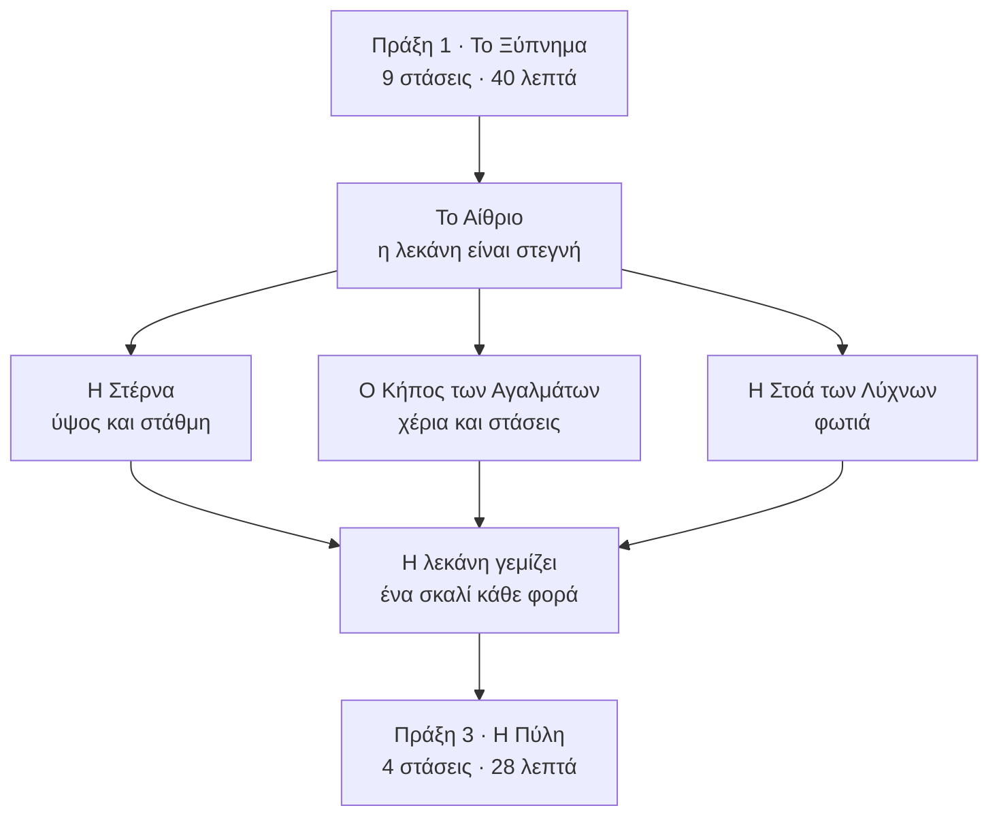

# EIDOLON · Κεφάλαιο 1: Η Πύλη με το Πέπλο

*Το flow του κεφαλαίου, ξαναγραμμένο από την αρχή. Αντικαθιστά το `CH1_V3.md` ως σχέδιο προς χτίσιμο, αν εγκριθεί. Οι αριθμοί «αρ.» παραπέμπουν στο `EIDOLON_PUZZLES_ALL.md`.*

Το κεφάλαιο 1 ξαναγραμμένο από την αρχή, με ό,τι αξίζει περισσότερο από τους 128 γρίφους. 21 γρίφοι, ένα αίθριο με τρεις πτέρυγες, μία πύλη που φαίνεται από το πρώτο λεπτό. Κύριος δρόμος 2 ώρες και 50 λεπτά, με τα προαιρετικά 3 ώρες και 20.

## Με μια ματιά

- **Ο στόχος.** Μια πύλη σκεπασμένη με ένα μεγάλο πανί, ψηλά πάνω από το αίθριο. Φαίνεται από την πρώτη αυλή. Όλο το κεφάλαιο είναι ο δρόμος ως εκεί.
- **Η ιδέα που τα δένει.** Εκείνος άδειασε τη μεγάλη λεκάνη του αιθρίου, γιατί «έδειχνε πάρα πολλά». Κάθε πτέρυγα τελειώνει σε έναν υδατοφράκτη. Κάθε φορά που ανοίγεις έναν, το νερό κατεβαίνει στο αίθριο και η λεκάνη γεμίζει ένα σκαλί. Στο τρίτο σκαλί το νερό φτάνει στα πόδια της Πύλης, και τότε μόνο μπορεί να τη φτάσει η αντανάκλαση.
- **Η σειρά.** Πράξη 1 γραμμική (40 λεπτά, μαθαίνεις τα ρήματα). Πράξη 2 με τρεις πτέρυγες σε όποια σειρά θέλεις (90 λεπτά, μία οικογένεια κανόνων η καθεμία). Πράξη 3 στην Πύλη (28 λεπτά, όλα μαζί και μια ανατροπή).
- **Τι κρατά από το demo.** Οι γρίφοι 1, 2 και 3 μένουν όπως είναι. Η αυλή του γερανού μένει ως σκηνικό, με γρίφο τριών κινήσεων στη θέση της αλυσίδας. Η τσέπη, οι στήλες και τα χρυσά χέρια γίνονται συστήματα όλου του κεφαλαίου.
- **Τι δεν έχει.** Κανέναν όρθιο καθρέφτη που να δουλεύει. Η Πύλη είναι το πρώτο γυαλί που βλέπει εκείνη, και γι' αυτό κρατώ τους καθρέφτες για το κεφάλαιο 2.

## Οι έξι κανόνες

| | Κανόνας | Τι λέει | Πού παίζεται |
|---|---|---|---|
| Κ1 | Στάση | Σε άδειο βάθρο γίνεται άγαλμα, και ό,τι μετρά αγάλματα τη μετρά. | Πράξη 1, Κήπος, Πύλη |
| Κ2 | Δεύτερο σώμα | Πατάς το νερό και η αντανάκλαση πηγαίνει εκεί, αν έχει πού να πατήσει. Ξεκινά πάντα από εκεί που στέκεται εκείνη. | παντού |
| Κ3 | Η αλήθεια του νερού | Όπου πάνω και κάτω διαφωνούν, δίκιο έχει το νερό. | Πράξη 1, Πύλη, Στοά των οκτώ καμαρών |
| Κ4 | Η επιφάνεια είναι πόρτα | Ό,τι αγγίξει το ακίνητο νερό γίνεται ένα με το είδωλό του. Τα πράγματα περνούν από χέρι σε χέρι. | Πράξη 1, Στέρνα, Λύχνοι |
| Κ5 | Ύψος και στάθμη | Όσο ψηλά στέκεται εκείνη, τόσο βαθιά στέκεται η αντανάκλαση. Ένα σκαλί νερό ανεβάζει τον κόσμο του δύο σκαλιά. | Στέρνα, αίθριο |
| Κ6 | Φως | Φωτιά υπάρχει μόνο κάτω, ώσπου να την ανεβάσεις. Όπου πέφτει η λάμψη της, το νερό παύει να είναι καθρέφτης. | Λύχνοι, Πύλη |

## Ο χάρτης

## Πόσο κρατά

| Μέρος | Τι έχει | Λεπτά |
|---|---|---:|
| Πράξη 1 | 9 στάσεις, 6 γρίφοι | 39 |
| Η Στέρνα | 4 γρίφοι και ένα πέρασμα | 28 |
| Ο Κήπος των Αγαλμάτων | 4 γρίφοι και ένα πέρασμα | 31 |
| Η Στοά των Λύχνων | 4 γρίφοι και ένα πέρασμα | 29 |
| Το αίθριο ανάμεσα | τρία νερά, δρόμοι επιστροφής | 15 |
| Πράξη 3 | 3 γρίφοι και ένα θέαμα | 28 |
| **Κύριος δρόμος** | 21 γρίφοι | **170** (2 ώ 50′) |
| Ονόματα, ενθύμια, μισά σκαλίσματα, στήλες | προαιρετικά | 30 |
| **Με όλα** | | **200** (3 ώ 20′) |

## Πράξη 1 · Το Ξύπνημα (40′)

Γραμμική, χωρίς αδιέξοδο. Κάθε στάση διδάσκει ένα ρήμα με έναν γρίφο λίγων κινήσεων. Ανάμεσα σε δύο γρίφους υπάρχει πάντα κάτι να περπατήσεις ή να κοιτάξεις.

### I.1 · Το βάθρο

*ιστορία · 3′ · χτισμένο · η πρώτη αυλή του demo*

Ξυπνά όρθια πάνω σε ένα βάθρο, σε μια σειρά αγαλμάτων με το δικό της σχήμα, στην αυλή της ακτής. Όλα έχουν πέπλο, όπως κι εκείνη. Ψηλά στο βάθος φαίνεται μια πύλη σκεπασμένη με ένα μεγάλο πανί.

1. Το πρώτο πάτημα την κατεβάζει από το βάθρο.
2. Περπατά, εξετάζει τη στήλη και έναν δεμένο καθρέφτη.

- **Τι αφήνει:** Τον στόχο του κεφαλαίου, και το ότι ήταν ένα από τα αγάλματα.
- **Στο παιχνίδι:** `i made her many times. i did not make her face`

### I.2 · Γίνε το άγαλμα

*γρίφος · 4′ · χτισμένο · γρίφος 1*

Η πόρτα της αυλής ανοίγει μόνο όταν η σειρά είναι πλήρης. Έξι βάθρα, πέντε αγάλματα.

1. Ψάχνει τι λείπει από τη σειρά.
2. Το άδειο βάθρο είναι αυτό απ' όπου κατέβηκε.
3. Ανεβαίνει, παίρνει τη στάση, η πόρτα ανοίγει και μένει ανοιχτή.

- **Η παγίδα:** Ψάχνεις ένα άγαλμα να φέρεις. Αυτό που λείπει είσαι εσύ.
- **Το «αχά»:** «Η πόρτα με μετρά για άγαλμα.»
- **Τι αφήνει:** Το ρήμα «στάση» (Κ1). Ο ίδιος μηχανισμός, σε μεγάλο, κλείνει το κεφάλαιο.

### I.3 · Το πέρασμα που κρατά το νερό

*γρίφος · 6′ · χτισμένο · γρίφος 2*

Το βαρούλκο της επόμενης πύλης στέκει σε βάθρο μέσα στη λίμνη. Πάνω δεν υπάρχει δρόμος ως εκεί. Στο νερό φαίνεται ένα πέτρινο πέρασμα.

1. Πατά το νερό: η αντανάκλαση βγαίνει από τα πόδια της.
2. Περπατά το πέρασμα που υπάρχει μόνο κάτω.
3. Γυρίζει το βαρούλκο· η πύλη πάνω ανοίγει.

- **Η παγίδα:** Κανένα πράγμα πάνω δεν σε πάει στο βαρούλκο.
- **Το «αχά»:** «Στο νερό υπάρχει δρόμος που εδώ δεν υπάρχει, κι εκείνη τον περπατά.»
- **Τι αφήνει:** Το ρήμα «πάτα το νερό» (Κ2).

### I.4 · Το κενό ανάμεσα σε δύο σιδεριές

*γρίφος · 5′ · νέο · αρ. 10*

Στενή αυλή με ένα κανάλι κατά μήκος. Πάνω, μια σιδεριά κλείνει τον δρόμο στο βάθος. Στο νερό, μια άλλη σιδεριά τον κλείνει στη μέση. Ο τροχός που σηκώνει την πάνω σιδεριά είναι πίσω της.

1. Από την είσοδο στέλνει την αντανάκλαση: σταματά στη σιδεριά που υπάρχει μόνο στο νερό.
2. Εκείνη προχωρά πάνω, όπου η μεσαία σιδεριά δεν υπάρχει, ως τη μία πλάκα ανάμεσα στις δύο.
3. Από εκεί τη στέλνει ξανά: η αντανάκλαση ξεκινά από τα πόδια της, ήδη πέρα από τη δική της σιδεριά, και περνά κάτω από τη σιδεριά εκείνης.
4. Γυρίζει τον τροχό από πίσω και η πάνω σιδεριά σηκώνεται.

- **Η παγίδα:** Η αντανάκλαση σταματά εκεί που εκείνη περνά, κι εκείνη εκεί που περνά η αντανάκλαση.
- **Το «αχά»:** «Ξεκινά από εκεί που στέκομαι. Τον μισό δρόμο τον κάνω εγώ για εκείνη.»
- **Τι αφήνει:** Την ερώτηση που θα κάνεις σε κάθε επόμενη αυλή: από πού τη στέλνω;

### I.5 · Η γέφυρα με τους δεμένους καθρέφτες

*πέρασμα · 2′ · χτισμένο · υπάρχει στο demo*

Η στενή γέφυρα με τους καθρέφτες τυλιγμένους και δεμένους με σκοινί. Κανένας δεν λύνεται. Η Πύλη φαίνεται πιο κοντά.

- **Τι αφήνει:** Τη φράση που θα πληρωθεί στο τέλος.
- **Στο παιχνίδι:** `a mirror under a cloth. the cloth is tied on the far side`

### I.6 · Τα γυρισμένα

*γρίφος · 6′ · χτισμένο · γρίφος 3*

Τρία αγάλματα με χρυσό χέρι σε γραναζωτά βάθρα γύρω από μια λίμνη. Στο νερό δείχνουν αλλού απ' ό,τι πάνω.

1. Συγκρίνει κάθε άγαλμα με το είδωλό του.
2. Γυρίζει τα βάθρα ώσπου τα τρία χέρια να δείχνουν όπως στο νερό.
3. Η πόρτα ανοίγει.

- **Η παγίδα:** Πάνω όλα φαίνονται στη θέση τους. Σωστό είναι αυτό που δείχνει το νερό.
- **Το «αχά»:** «Όταν πάνω και κάτω διαφωνούν, δίκιο έχει το νερό.»
- **Τι αφήνει:** Τον κανόνα Κ3 και τα γραναζωτά βάθρα. Το χρυσό χέρι θα αποκτήσει δεύτερη χρήση στον Κήπο.

### I.7 · Η πόρτα που έχτισε

*γρίφος · 4′ · χτισμένο κατά το μισό · αρ. 30 (πρώτο μισό) και αρ. 97*

Αυλή χωρίς έξοδο. Στο νερό, ο δυτικός τοίχος έχει μια πόρτα. Πάνω, ο ίδιος τοίχος είναι σκέτος.

1. Στέλνει την αντανάκλαση: περνά την πόρτα του νερού και γυρίζει με άδεια χέρια.
2. Πατά τον τοίχο πάνω: εκείνη τον σπρώχνει με τις δύο παλάμες.
3. Ο σοβάς ραγίζει και πέφτει. Από κάτω, η πόρτα.

- **Η παγίδα:** Είναι η πρώτη φορά που η αντανάκλαση δεν είναι η λύση.
- **Το «αχά»:** «Το νερό δεν δείχνει μόνο ό,τι μου λείπει. Δείχνει και ό,τι εκείνος έκρυψε.»
- **Τι αφήνει:** Το Κ3 από την ανάποδη. Ο τοίχος με το ρήγμα, στην Πύλη, είναι το ίδιο μάθημα.
- **Στο παιχνίδι:** `i closed that door the day she found it`

### I.8 · Ο άδειος γάντζος

*γρίφος · 5′ · χτισμένο κατά το μισό · αρ. 11, στη θέση του γρίφου 4*

Η αυλή του γερανού. Η πόρτα προς το αίθριο έχει κλειδαριά. Ο γάντζος κρέμεται άδειος πάνω από τη λίμνη. Στο νερό, ο ίδιος γάντζος κρατά ένα κλειδί.

1. Στέλνει την αντανάκλαση: κάτω από τον γάντζο δεν υπάρχει πάτημα, και γυρίζει πίσω.
2. Γυρίζει τη μανιβέλα: ο άδειος γάντζος κατεβαίνει ώσπου να αγγίξει την επιφάνεια.
3. Γάντζος και είδωλο γίνονται ένα. Τον ανεβάζει και το κλειδί στάζει πάνω του.
4. Ξεκλειδώνει.

- **Η παγίδα:** Κανείς δεν χρειάζεται να πάει πουθενά.
- **Το «αχά»:** «Ό,τι αγγίξει το ακίνητο νερό συναντά το είδωλό του.»
- **Τι αφήνει:** Τον κανόνα Κ4. Γυρίζει ανάποδα στη Στέρνα και με φωτιά στον Μεγάλο Λύχνο.

### I.9 · Το Αίθριο της στεγνής λεκάνης

*θέαμα · 4′ · νέο · δικό του*

Βγαίνει σε ένα μεγάλο αίθριο. Στη μέση, μια στρογγυλή λεκάνη τρία σκαλιά βαθιά, στεγνή. Τρία μαρμάρινα αυλάκια έρχονται από τρεις πτέρυγες, στεγνά κι αυτά. Στο βόρειο χείλος, στην κορυφή μιας σκάλας, η Πύλη με το πανί. Δύο λύχνοι δεξιά κι αριστερά της, σβηστοί.

1. Πατά τη λεκάνη: εκείνη σκύβει και κοιτά. Δεν υπάρχει νερό, άρα δεν υπάρχει κανείς.
2. Ανεβαίνει ως την Πύλη: αμπαρωμένη, σκεπασμένη, δεμένη από πίσω.
3. Τρεις δρόμοι ανοίγουν.

- **Τι αφήνει:** Το θέλημα του κεφαλαίου χωρίς μία λέξη: φέρε πίσω το νερό.
- **Στο παιχνίδι:** `a pool this size shows too much. i let it run dry`

- Ενθύμιο: η χτένα. Αφού πάρεις το κλειδί, κατεβάζεις τον γάντζο δεύτερη φορά. Στο νερό κρατά τώρα κάτι άλλο.

## Το αίθριο ανάμεσα στις πτέρυγες

Οι πτέρυγες παίζονται με όποια σειρά θέλεις. Το αίθριο μετρά πόσες έχεις τελειώσει, όχι ποιες.

- **Πρώτο νερό.** Το νερό σκεπάζει το κάτω σκαλί: ένας δίσκος καθρέφτη στη μέση. Το αίθριο έχει για πρώτη φορά αντανάκλαση. Στο μέτωπο του σκαλιού, ένα μισό σκάλισμα ολοκληρώνεται με το είδωλό του: ένας καθρέφτης χειρός.
- **Δεύτερο νερό.** Ο καθρέφτης φτάνει ως τα πλάγια χείλη. Το δεύτερο σκάλισμα: μια μορφή όρθια πάνω στη γραμμή του νερού γίνεται δύο μορφές ενωμένες στα πόδια. Η κάτω έχει γυρίσει το κεφάλι αλλού.
- **Τρίτο νερό.** Το νερό φτάνει στα πόδια της Πύλης. Η αψίδα της γίνεται κύκλος. Αρχίζει η πράξη 3.

Κάθε φορά συμβαίνουν τα ίδια δύο πράγματα. Στέλνεις την αντανάκλαση προς την Πύλη και σταματά εκεί που τελειώνει το νερό, κάθε φορά πιο κοντά: βλέπεις μόνος σου πόσο απέχεις. Και ένα φύσημα περνά πάνω από το καινούργιο νερό, η αντανάκλαση σβήνει και ξαναβρίσκεται στα πόδια της. Έτσι μαθαίνεις, χωρίς να χάσεις τίποτα, ότι στη ρυτίδα δεν υπάρχει καθρέφτης. Είναι ο Φύλακας, και στο κεφάλαιο αυτό δεν είναι παρά ένας αέρας και, στο τέλος, ένα μάτι. Οι στάσεις στο αίθριο κρατούν περίπου 3 λεπτά η καθεμία.

## Πτέρυγα · Η Στέρνα (28′)

Ύψος και στάθμη (Κ5). Εδώ εκείνος έκρυψε τους καθρέφτες βουλιάζοντάς τους: στον πάτο της στέρνας κείτονται χάλκινοι δίσκοι, μπρούμυτα.

### Σ.1 · Ανέβα για να κατέβει

*γρίφος · 4′ · νέο · αρ. 68*

Ένα βαθύ φρεάτιο δίπλα στη σκαλωσιά του γλύπτη. Ο μοχλός της πόρτας βρίσκεται σε ένα πατάρι τρία πατώματα κάτω, και υπάρχει μόνο στο νερό.

1. Από το χείλος στέλνει την αντανάκλαση: στέκεται ακριβώς κάτω από την επιφάνεια, κοιτά κάτω, σκάλα δεν έχει.
2. Εκείνη ανεβαίνει στο πρώτο πατάρι της σκαλωσιάς. Στο νερό, η αντανάκλαση στέκεται τώρα ένα πάτωμα πιο βαθιά.
3. Ανεβαίνει στο τρίτο. Η αντανάκλαση είναι στο πατάρι με τον μοχλό και τον τραβά.

- **Η παγίδα:** Ψάχνεις σκάλα μέσα στο νερό. Η σκάλα είναι πάνω.
- **Το «αχά»:** «Όσο ψηλώνω, εκείνη βαθαίνει.»

### Σ.2 · Το ψηλότερο νερό

*γρίφος · 7′ · νέο · αρ. 47*

Δύο λεκάνες δίπλα δίπλα, η καθεμία με υδατοφράκτη τριών εγκοπών, και ένα άνοιγμα στον μεσότοιχο. Το καθρεφτισμένο πατάρι της πρώτης είναι δύο σκαλιά χαμηλότερα από το κατώφλι της δεύτερης, όπου βρίσκεται ο μοχλός. Τη στέλνει από ένα χαμηλό πεζούλι στην πρώτη λεκάνη.

1. Στέλνει την αντανάκλαση: φτάνει στο άνοιγμα και βρίσκει το κατώφλι δύο σκαλιά πάνω από το κεφάλι της.
2. Ανεβάζει το νερό της πρώτης μία εγκοπή. Ο κόσμος μέσα της ανεβαίνει δύο σκαλιά και τα δάπεδα ισιώνουν, αλλά το πεζούλι απ' όπου τη στέλνει είναι πια κάτω από το νερό.
3. Το ξανακατεβάζει. Κατεβάζει τη δεύτερη λεκάνη μία εγκοπή: ο δικός της κόσμος πέφτει δύο σκαλιά.
4. Η αντανάκλαση περνά το άνοιγμα και τραβά τον μοχλό.

- **Η παγίδα:** Το προφανές, να σηκώσεις το χαμηλό, σου παίρνει το πάτημα. Η λύση είναι να κατεβάσεις το ψηλό.
- **Το «αχά»:** «Ένα σκαλί νερό, δύο σκαλιά κόσμος.»

### Σ.3 · Ο πάτος και η μισή ρόδα

*γρίφος · 8′ · νέο · αρ. 13 και αρ. 27*

Η μεγάλη στέρνα, με τρεις στάθμες. Στον βόρειο τοίχο μια χάλκινη ρόδα κομμένη στη μέση: το πάνω μισό στη θέση του, το κάτω λείπει. Η ρόδα ανοίγει τη βαθιά πόρτα. Την πρώτη φορά που αδειάζει η στέρνα, ο πάτος της φανερώνεται: ένα πρόσωπο οκτώ μέτρων, λείο, χωρίς χαρακτηριστικά.

1. Με τη στέρνα άδεια περπατά στον πάτο ως τη ρόδα. Μισή ρόδα δεν γυρίζει, και χωρίς νερό δεν υπάρχει αντανάκλαση.
2. Με τη στέρνα γεμάτη η αντανάκλαση φτάνει, αλλά η ρόδα είναι βουτηγμένη και ο διάδρομος εκείνης πνιγμένος.
3. Στη μεσαία στάθμη το νερό κόβει τη ρόδα ακριβώς στον άξονα. Το μισό και το είδωλό του κάνουν ρόδα ολόκληρη.
4. Στέκεται στη ρόδα και στέλνει την αντανάκλαση στο δικό της μισό.
5. Σπρώχνουν εναλλάξ, εκείνη το μισό του αέρα και η αντανάκλαση το μισό του νερού. Τέσσερα σπρωξίματα και η πόρτα ανοίγει.

- **Η παγίδα:** Και τα δύο άκρα αποτυγχάνουν μπροστά στα μάτια σου. Μόνο η μέση δίνει πάτημα και στις δύο.
- **Το «αχά»:** «Τη μισή τη σκάλισε εκείνος. Την άλλη μισή τη δίνει το νερό.»
- **Τι αφήνει:** Τα μισά σκαλίσματα ως σύστημα. Τα τρία του αιθρίου δουλεύουν με τον ίδιο τρόπο.

### Σ.4 · Φέρε το νερό στον γάντζο

*γρίφος · 6′ · νέο · αρ. 11 ανάποδα, με αρ. 59 · κορύφωση*

Ο θάλαμος της εκροής. Ο φράκτης προς το αίθριο δεν έχει λαβή. Ένα βαρούλκο κρατά έναν γάντζο πάνω από το νερό, άδειο. Στο νερό ο γάντζος κρατά τη λαβή. Το σκοινί είναι κοντό.

1. Κατεβάζει τον γάντζο όπως στην αυλή του γερανού: το σκοινί τελειώνει δύο πήχες πάνω από την επιφάνεια.
2. Ανεβάζει τη στάθμη του θαλάμου ώσπου το νερό να αγγίξει τον γάντζο. Γίνονται ένα.
3. Το νερό όμως σκέπασε τον εξώστη απ' όπου φτάνει τον γάντζο. Το ξανακατεβάζει.
4. Παίρνει τη λαβή, τη βάζει στον φράκτη, γυρίζει. Το νερό τρέχει στο δυτικό αυλάκι.

- **Η παγίδα:** Ο κανόνας που ήξερες δεν φτάνει ως εκεί. Αντί να πας το πράγμα στο νερό, φέρνεις το νερό στο πράγμα.
- **Το «αχά»:** «Το νερό έρχεται όπου το φωνάξω.»
- **Τι αφήνει:** Το πρώτο σκαλί νερού στο αίθριο, και μια πόρτα που βγάζει κατευθείαν πίσω.

- Πέρασμα: ο πάτος με το λείο πρόσωπο και τους βουλιαγμένους καθρέφτες, την πρώτη φορά που αδειάζει η στέρνα.
- Ενθύμιο: το κοχύλι, σε μια κόγχη ακριβώς κάτω από την επιφάνεια του φρεατίου. Στέκεται στο χαμηλότερο σκαλί, ώστε η αντανάκλαση να βρεθεί ψηλά: «κατέβα για να ανέβει».

## Πτέρυγα · Ο Κήπος των Αγαλμάτων (31′)

Χέρια και στάσεις (Κ1 και Κ2). Εδώ έκρυψε τους καθρέφτες γυρίζοντάς τους στον τοίχο και στήνοντας ένα άγαλμα μπροστά στον καθένα.

### Κ.1 · Η παλάμη

*γρίφος · 4′ · νέο · αρ. 19 (πρώτο μισό)*

Στρογγυλή λίμνη με ένα νησάκι στη μέση, όπου στέκει ο μοχλός της πόρτας. Πέρασμα δεν υπάρχει, ούτε στο νερό. Στο χείλος, ένα άγαλμα σε γραναζωτό βάθρο απλώνει το χρυσό του χέρι πάνω από το νερό.

1. Στέλνει την αντανάκλαση προς το νησάκι: δεν έχει πού να πατήσει.
2. Πατά το χρυσό χέρι μέσα στο νερό: η αντανάκλαση ανεβαίνει στην καθρεφτισμένη παλάμη.
3. Γυρίζει το βάθρο. Το χέρι σαρώνει πάνω από τη λίμνη και την αφήνει στο νησάκι.

- **Η παγίδα:** Ψάχνεις δρόμο. Ο δρόμος είναι ένα χέρι.
- **Το «αχά»:** «Το χρυσό, μέσα στο νερό, πατιέται.»

### Κ.2 · Από χέρι σε χέρι

*γρίφος · 8′ · νέο · αρ. 19, με αρ. 23*

Μακριά λίμνη, τρία αγάλματα με χρυσό χέρι στο χείλος. Τα δύο πρώτα βάθρα είναι δεμένα με γρανάζια: όταν γυρίζει το ένα, το άλλο γυρίζει ανάποδα. Το τρίτο είναι ελεύθερο.

1. Η αντανάκλαση ανεβαίνει στην πρώτη παλάμη.
2. Γυρίζει το πρώτο βάθρο: το δεύτερο γυρίζει ανάποδα και οι δύο παλάμες προσπερνούν η μία την άλλη.
3. Βρίσκει τη θέση όπου συναντιούνται. Η αντανάκλαση περνά στη δεύτερη.
4. Τώρα κάθε στροφή του δεύτερου κουνά και το πρώτο. Στήνει πρώτα το ελεύθερο τρίτο να περιμένει.
5. Γυρίζει το ζευγάρι ώσπου η δεύτερη παλάμη να βρει την τρίτη. Η αντανάκλαση περνά και κατεβαίνει απέναντι.

- **Η παγίδα:** Γυρίζεις το άγαλμα που την κρατά και χαλάς το επόμενο πέρασμα.
- **Το «αχά»:** «Στήνω πρώτα το χέρι που θα τη δεχτεί.»

### Κ.3 · Τι θέλει το καθένα

*γρίφος · 8′ · νέο · αρ. 84, με τη ράγα του αρ. 82*

Ημικυκλική εξέδρα με πέντε θέσεις πάνω σε ράγα, τέσσερα αγάλματα και μια ρηχή λεκάνη μπροστά. Πάνω κοιτούν όλα ίσια. Στο νερό το καθένα κοιτά αλλού: ένα τη θάλασσα, ένα το διπλανό του, ένα τον τοίχο, ένα την άδεια θέση.

1. Πατά ένα άγαλμα: γλιστρά πάνω στη ράγα στην ελεύθερη θέση.
2. Βάζει αυτό που κοιτά τη θάλασσα στην άκρη με το άνοιγμα, και αυτό που κοιτά τον τοίχο στην άλλη.
3. Βάζει αυτό που κοιτά το διπλανό του δίπλα σε εκείνο που θέλει.
4. Το τέταρτο κοιτά πάντα την άδεια θέση, όπου κι αν βρεθεί.
5. Ανεβαίνει η ίδια στην άδεια θέση και παίρνει τη στάση. Τα τέσσερα σκύβουν το κεφάλι και η πόρτα ανοίγει.

- **Η παγίδα:** Όπως και να τα βάλεις, ένα μένει ανικανοποίητο. Αυτό που θέλει δεν είναι πέτρα.
- **Το «αχά»:** «Ένα από αυτά ήθελε εμένα.»
- **Τι αφήνει:** Μια ανάσα χωρίς αντανάκλαση ανάμεσα σε δύο γρίφους με δύο σώματα. Δένει με τα δώδεκα ονόματα.

### Κ.4 · Η Καρυάτιδα που λείπει

*γρίφος · 8′ · νέο · αρ. 37, με την παλάμη · κορύφωση*

Το σπίτι της πηγής. Στην πρόσοψη έξι θέσεις, πέντε Καρυάτιδες. Το υπέρθυρο γέρνει και η χάλκινη πόρτα δεν σέρνεται. Μπροστά μια λίμνη, και δίπλα της ένα άγαλμα με χρυσό χέρι σε γραναζωτό βάθρο.

1. Παίρνει τη θέση της έκτης, με το χέρι ψηλά. Το υπέρθυρο ισιώνει, αλλά αν κατέβει ξαναγέρνει.
2. Από εκεί στέλνει την αντανάκλαση. Στο νερό οι Καρυάτιδες είναι έξι, άρα η αντανάκλαση είναι ελεύθερη. Ανάμεσα στο χείλος και την καθρεφτισμένη πόρτα όμως υπάρχει κενό.
3. Κατεβαίνει και γυρίζει το άγαλμα, ώστε η χρυσή παλάμη να γεφυρώνει το κενό.
4. Ξαναπαίρνει τη θέση.
5. Η αντανάκλαση περνά από την παλάμη, σέρνει την καθρεφτισμένη πόρτα και βάζει τον πείρο που κρατά το υπέρθυρο για πάντα.
6. Κατεβαίνει. Η πόρτα είναι ανοιχτή. Ανοίγει την πηγή και το νερό τρέχει στο ανατολικό αυλάκι.

- **Η παγίδα:** Μόλις ισιώσεις το υπέρθυρο δεν μπορείς να κουνηθείς. Ό,τι χρειάζεται η αντανάκλαση πρέπει να το έχεις στήσει πριν πετρώσεις.
- **Το «αχά»:** «Εγώ κρατάω. Εκείνη περνά.»
- **Τι αφήνει:** Τη σειρά «στήσε, πέτρωσε, στείλε», που είναι ο σκελετός του τελικού.

- Πέρασμα: η αλέα με τα κεφάλια που δοκίμασε και άφησε στην άκρη, όλο και πιο ατελή όσο προχωράς.
- Ενθύμιο: η σμίλη που του πήρε κρυφά, στην αληθινή παλάμη ενός αγάλματος που δείχνει προς τη θάλασσα. Γυρίζεις το δεμένο του ζευγάρι ώσπου η παλάμη να έρθει πάνω από το χείλος.

## Πτέρυγα · Η Στοά των Λύχνων (29′)

Φωτιά (Κ6). Ψηλά, πάνω από το αίθριο. Σκεπαστή και σκιερή, όχι σκοτεινή. Εδώ έκρυψε τους καθρέφτες μαυρίζοντάς τους με την κάπνα των λύχνων.

### Λ.1 · Η φλόγα που καίει μόνο κάτω

*γρίφος · 5′ · νέο · αρ. 20 (πρώτο μισό)*

Σκεπαστή στοά πάνω από ένα μακρύ κανάλι. Όλοι οι λύχνοι είναι σβηστοί. Η πόρτα είναι σφραγισμένη με κερί, και κάτω από τη σφραγίδα στέκει ένας λύχνος. Στο νερό, στην άκρη του καναλιού, ένα μικρό λυχνάρι καίει.

1. Στέλνει την αντανάκλαση ως το λυχνάρι του νερού. Εκείνη ανάβει ένα καλάμι.
2. Η αντανάκλαση γυρίζει στο χείλος. Εκείνη γονατίζει και η φλόγα περνά από χέρι σε χέρι μέσα από την επιφάνεια.
3. Ανάβει τον λύχνο κάτω από τη σφραγίδα. Το κερί λιώνει και η πόρτα ανοίγει.

- **Η παγίδα:** Φωτιά δεν υπάρχει πουθενά πάνω.
- **Το «αχά»:** «Τη φωτιά μού τη δίνει εκείνη.»

### Λ.2 · Το φως σβήνει το πάτημα

*γρίφος · 7′ · νέο · αρ. 20*

Λίμνη με ένα μονοπάτι σε σχήμα Τ που υπάρχει μόνο στο νερό. Πάνω του τέσσερις λύχνοι σε νησάκια, που τους φτάνει μόνο η αντανάκλαση. Κάθε λύχνος που ανάβει κάτω ανάβει και πάνω, και η λάμψη του σβήνει το κομμάτι του μονοπατιού γύρω του. Καθένας έχει μια αλυσίδα ως το χείλος, που του ρίχνει ένα χάλκινο καπάκι. Και οι τέσσερις πρέπει να καίνε.

1. Η αντανάκλαση ανάβει τον πρώτο λύχνο που βρίσκει. Το μονοπάτι γύρω του χάνεται και οι άλλοι τρεις δεν φτάνονται.
2. Εκείνη τραβά την αλυσίδα: το καπάκι πέφτει, ο λύχνος σβήνει, το μονοπάτι ξαναφαίνεται.
3. Η αντανάκλαση πηγαίνει πρώτα στον πιο μακρινό, τον ανάβει και κάνει ένα βήμα πίσω.
4. Γυρίζει προς τα έξω ανάβοντας: το ένα σκέλος του Τ, μετά το άλλο, τελευταίος ο κοντινός.

- **Η παγίδα:** Ανάβεις όπως περπατάς και κόβεις τον δρόμο σου.
- **Το «αχά»:** «Το φως και ο καθρέφτης δεν χωρούν στο ίδιο νερό. Εκείνη ανάβει, εγώ σβήνω.»

### Λ.3 · Φώναξέ τη με το φως

*γρίφος · 7′ · νέο · αρ. 69*

Ανοιχτό δώμα. Εδώ φυσά: η μεγάλη λεκάνη ρυτιδώνει και δεν κρατά είδωλο. Μόνο ένα στενό ρείθρο στο απάγκιο του τοίχου μένει ακίνητο, με διακλαδώσεις και πέντε λύχνους κατά μήκος του. Τους λύχνους αυτούς τους φτάνει εκείνη. Η αντανάκλαση περπατά μόνη της προς τον κοντινότερο αναμμένο λύχνο και σταματά στην άκρη της λάμψης του.

1. Πατά το νερό: ρυτίδες, κανείς.
2. Ανάβει τον πρώτο λύχνο. Η αντανάκλαση εμφανίζεται στο ρείθρο και έρχεται προς το φως.
3. Ανάβει τον δεύτερο και σκεπάζει τον πρώτο. Στη διακλάδωση δύο αναμμένοι την τραβούν προς τον κοντινότερο, και σκεπάζει τον λάθος.
4. Ο μοχλός βρίσκεται κάτω από τον τέταρτο λύχνο. Όσο καίει, η λάμψη του σβήνει το νερό γύρω από τον μοχλό, κι εκείνη σταματά πριν φτάσει.
5. Ανάβει τον πέμπτο, πιο πέρα, και σκεπάζει τον τέταρτο. Η αντανάκλαση περνά από τον μοχλό πηγαίνοντας προς το μακρινό φως, και τον τραβά.

- **Η παγίδα:** Το φως που τη φέρνει είναι το ίδιο που δεν την αφήνει να φτάσει.
- **Το «αχά»:** «Δεν τη στέλνω. Τη φωνάζω, κι έρχεται επειδή το θέλει.»
- **Τι αφήνει:** Το πρώτο σημάδι ότι εκείνη έχει δική της θέληση.

### Λ.4 · Ο Μεγάλος Λύχνος

*γρίφος · 7′ · νέο · αρ. 11 (δεύτερη μορφή), αρ. 21, αρ. 20 ανάποδα · κορύφωση*

Στρογγυλή αίθουσα με λίμνη. Από τον θόλο κρέμεται με αλυσίδα και τροχαλία ο Μεγάλος Λύχνος, σβηστός. Στο νερό ο ίδιος λύχνος καίει. Στο χείλος τέσσερις λύχνοι, που ανάβουν μόνοι τους από το ρείθρο του λαδιού μόλις μπει. Πάνω από την πόρτα της εκροής, μια μεγάλη σφραγίδα από κερί.

1. Κατεβάζει τον Μεγάλο Λύχνο ώσπου να αγγίξει το νερό, όπως τον γάντζο. Δεν γίνεται τίποτα: εκεί που αγγίζει, το νερό λάμπει από τους τέσσερις λύχνους και δεν δείχνει είδωλο.
2. Σκεπάζει τους τέσσερις, έναν έναν. Με κάθε καπάκι ένα τέταρτο της λίμνης ξαναγίνεται καθρέφτης.
3. Κατεβάζει ξανά. Ο σβηστός λύχνος αγγίζει το αναμμένο είδωλό του και ανάβει.
4. Τον ανεβάζει. Η ζέστη του λιώνει τη σφραγίδα και το νερό πέφτει στο ψηλό αυλάκι.

- **Η παγίδα:** Όλη την πτέρυγα άναβες. Το τέλος ζητά να σβήσεις.
- **Το «αχά»:** «Για να πάρω τη μεγάλη φωτιά, σβήνω τις μικρές.»
- **Τι αφήνει:** Η φωτιά τρέχει στο ρείθρο ως το αίθριο και ανάβει τους δύο λύχνους της Πύλης. Στον τελικό θα σου σταθούν εμπόδιο.

- Πέρασμα: η στοά με τους καπνισμένους καθρέφτες. Τρίβει έναν με το δάχτυλο και φαίνεται μια λωρίδα από το πέπλο της. Όταν ανάψει ο Μεγάλος Λύχνος, όλοι οι λύχνοι της στοάς πιάνουν ο ένας μετά τον άλλον.
- Ενθύμιο: το λυχνάρι της. Ένα παρακλάδι του ρείθρου δεν οδηγεί πουθενά. Τη φωνάζεις ως εκεί και βγαίνει κρατώντας το.

## Πράξη 3 · Η Πύλη (28′)

Και οι τρεις υδατοφράκτες ανοιχτοί. Η λεκάνη είναι γεμάτη ως τα πόδια της Πύλης. Εδώ γυρίζουν όλοι οι κανόνες, και στο τέλος ένας γυρίζει ανάποδα.

### III.1 · Η γεμάτη λεκάνη

*θέαμα · 2′ · νέο · αρ. 27*

Το τρίτο νερό φτάνει. Η μισή αψίδα της Πύλης και το είδωλό της κάνουν έναν ολόκληρο κύκλο. Μέσα στο νερό φαίνεται η ίδια σκάλα με ένα σκαλοπάτι σπασμένο, και ο τοίχος δίπλα στην Πύλη με ένα ρήγμα που πάνω δεν υπάρχει.

- **Τι αφήνει:** Ο αληθινός ναός είναι ερείπιο. Το νερό το δείχνει πρώτη φορά καθαρά.

### III.2 · Η Πύλη μετρά αγάλματα

*γρίφος · 12′ · νέο · αρ. 3 και αρ. 1 ανάποδα, με Κ.4, Λ.4 και I.7 · ο τελικός*

Η Πύλη είναι αμπαρωμένη και σκεπασμένη. Τα σκοινιά του πανιού είναι δεμένα από την πίσω πλευρά πάνω στην αμπάρα: όσο η αμπάρα κρέμεται, οι κόμποι είναι σφιχτοί σαν πέτρα. Μπροστά στη σκάλα μια σειρά βάθρων με αγάλματα και ένα άδειο, δεμένο με αλυσίδα στην αμπάρα. Δεξιά κι αριστερά οι δύο λύχνοι, που τώρα καίνε. Στο πλάι, ένα άγαλμα με χρυσό χέρι σε γραναζωτό βάθρο.

1. Στέλνει την αντανάκλαση προς τη σκάλα του νερού. Στο πόδι της το νερό λάμπει από τους δύο λύχνους και δεν κρατά είδωλο. Τους σκεπάζει και τους δύο.
2. Η αντανάκλαση ανεβαίνει ως το σπασμένο σκαλοπάτι. Εκείνη γυρίζει το άγαλμα, και η χρυσή παλάμη γεμίζει το κενό.
3. Η αντανάκλαση φτάνει στην πύλη του νερού, αμπαρωμένη κι αυτή. Περνά από το ρήγμα του τοίχου στην πίσω πλευρά.
4. Τρεις κόμποι. Δοκιμάζει τον πρώτο: το βάρος της αμπάρας τον κρατά σφιχτό.
5. Εκείνη ανεβαίνει στο άδειο βάθρο και παίρνει τη στάση. Η αμπάρα σηκώνεται και τα σκοινιά χαλαρώνουν.
6. Η αντανάκλαση λύνει τους τρεις κόμπους. Το πανί γλιστρά από την Πύλη, πέφτει στη λεκάνη και απλώνεται πάνω στο νερό.
7. Ο καθρέφτης σκεπάστηκε. Η αντανάκλαση κόπηκε στην πίσω πλευρά, κι εκείνη μένει πέτρα πάνω στο βάθρο. Πατάς το πάτωμα: τίποτα. Πατάς το νερό: είναι πανί.
8. Η Πύλη, ξεσκέπαστη, είναι από γυαλισμένο χαλκό: ο πρώτος καθρέφτης που βλέπει στη ζωή της. Την πατάς. Μέσα στον χαλκό φαίνεται η αντανάκλαση να έρχεται από πίσω και να σπρώχνει. Τα φύλλα ανοίγουν.
9. Η αντανάκλαση τραβά το πανί κάτω από το νερό και της το δίνει στα πόδια του βάθρου, από χέρι σε χέρι. Εκείνη ξυπνά, με το πανί στην τσέπη.
10. Ανεβαίνει τη σκάλα και περνά.

- **Η παγίδα:** Δύο φορές. Πρώτα: ό,τι χρειάζεται η αντανάκλαση πρέπει να στηθεί πριν πετρώσεις. Μετά: το πάτημα στο νερό, που έλυνε τα πάντα ως τώρα, δεν κάνει τίποτα.
- **Το «αχά»:** «Χωρίς εκείνη είμαι πέτρα. Και την τελευταία πόρτα μού την άνοιξε εκείνη.»
- **Τι αφήνει:** Το ένα πανί του παιχνιδιού, δοσμένο από την αντανάκλαση.

### III.3 · Η Στοά των οκτώ καμαρών

*γρίφος · 8′ · νέο · αρ. 30 (δεύτερο μισό)*

Πίσω από την Πύλη, μια στοά δίπλα σε ένα κανάλι ακίνητου νερού. Στο τέλος της βρίσκεις πάλι την αρχή της. Στην είσοδο οκτώ μικροί λύχνοι μετρούν πόσες καμάρες έχεις περάσει σωστά.

1. Σε κάθε καμάρα συγκρίνει το πάνω με το κάτω.
2. Αν διαφέρουν κάπου, γυρίζει πίσω. Αν ταιριάζουν παντού, προχωρά.
3. Οι διαφορές λεπταίνουν: ένας λύχνος που λείπει, ένα άγαλμα γυρισμένο, μια πόρτα μόνο στο νερό, μια στήλη με μία γραμμή παραπάνω.
4. Στην έκτη καμάρα όλα ταιριάζουν, εκτός από την ίδια την αντανάκλαση: έχει σταματήσει και την κοιτάζει.
5. Οκτώ σωστές στη σειρά και η στοά τελειώνει. Ένα λάθος μηδενίζει τους λύχνους, τίποτε άλλο.

- **Η παγίδα:** Ο διάδρομος δεν τελειώνει περπατώντας. Τελειώνει κοιτώντας.
- **Το «αχά»:** «Η διαφορά, αυτή τη φορά, ήταν εκείνη.»
- **Τι αφήνει:** Το Κ3 ως εξέταση, και η τελευταία προετοιμασία για τη σκηνή που ακολουθεί.

### III.4 · Το πρώτο ιερό: το χέρι στο νερό

*γρίφος · 6′ · νέο · δικό του, με το ένα πανί*

Στρογγυλό δωμάτιο με μια στρογγυλή λίμνη. Στον απέναντι τοίχο ένας μεγάλος καθρέφτης, ξεσκέπαστος: ο μόνος που άφησε, για να κοιτά ο ίδιος. Στο βάθος του ανοίγει ένα μάτι. Όσο κοιτά, η λίμνη τρέμει και δεν κρατά είδωλο.

1. Πατά το νερό: ρυτίδες, κανείς.
2. Πατά τον καθρέφτη: τινάζει πάνω του το πανί. Το μάτι τυφλώνεται και το νερό ησυχάζει.
3. Η αντανάκλαση ανεβαίνει μόνη της στην επιφάνεια. Δεν τη μιμείται. Ακουμπά την παλάμη της στο νερό.
4. Εκείνη γονατίζει και οι παλάμες συναντιούνται. Η αντανάκλαση γράφει με το δάχτυλο στο νερό: FIND ME.

- **Η παγίδα:** Όλο το κεφάλαιο εκείνος σκέπαζε καθρέφτες για να μη δει εκείνη. Το πανί έχει μία χρήση, και είναι η δική του κίνηση γυρισμένη εναντίον του.
- **Το «αχά»:** «Το πέπλο ήταν δικό του, όχι δικό μου.»
- **Τι αφήνει:** Το ερώτημα του κεφαλαίου 2: ποια είναι εκείνη, και ποιος είναι εκείνος. Πίσω από το πανί το γυαλί ραγίζει.
- **Στο παιχνίδι:** `the veil was his. not mine`

## Τα στρώματα που τρέχουν σε όλο το κεφάλαιο

- **Στήλες του γλύπτη** (χτισμένο · αρ. Σ, «πράγματα που εξετάζεις»). Μία σε κάθε αυλή, γύρω στις εικοσιτέσσερις. Το πρώτο πάτημα δίνει μια φράση του, το δεύτερο μια πλάγια υπόδειξη. Η φωνή του αλλάζει μέσα στο κεφάλαιο: στην πράξη 1 αρνείται («she is not lost. she is only behind the veil»), στις πτέρυγες δικαιολογείται, στην πράξη 3 ραγίζει.
- **Τα δώδεκα ονόματα** (αρ. 31 · 8 λεπτά). Στο αίθριο μια στήλη απαριθμεί δώδεκα αγάλματα με αυτό που ήθελε να είναι εκείνη: «the one who waits», «the one who never goes down to the sea». Δώδεκα βάθρα έχουν άγραφη χάλκινη πλάκα: τα τρία γυρισμένα, τα τέσσερα της εξέδρας, οι πέντε Καρυάτιδες. Τα αναγνωρίζεις από τη στάση και από το τι κοιτά το είδωλό τους. Κάθε ομάδα που κλειδώνει ανοίγει ένα συρτάρι στη βάση της στήλης, με μια κέρινη πλάκα του.
- **Τα μισά σκαλίσματα** (αρ. 27 · 6 λεπτά). Τρία στα σκαλιά της λεκάνης και η μισή ρόδα είναι στον κύριο δρόμο. Άλλα τέσσερα είναι κρυμμένα, ένα στην πράξη 1 και ένα σε κάθε πτέρυγα, και ολοκληρώνονται με τον κανόνα της αυλής τους.
- **Τα ενθύμιά της** (αρ. 57 · 10 λεπτά). Τέσσερα μικρά πράγματα δικά της: χτένα, κοχύλι, σμίλη, λυχνάρι. Το καθένα ζητά τον κανόνα της αυλής του από την ανάποδη. Μπαίνουν στην κρυψώνα της, πίσω από μια χαλαρή πλάκα στο αίθριο, σε τέσσερις κοιλότητες με το σχήμα τους. Με τα τέσσερα ανοίγει το βάθος της κρυψώνας: η άδεια θήκη ενός καθρέφτη χειρός.
- **Ρώτα την αντανάκλασή σου** (αρ. 36). Στέκεται δίπλα σε ακίνητο νερό και πατάς την ίδια. Η αντανάκλαση δεν τη μιμείται: πρώτα γυρίζει το κεφάλι προς αυτό που μετράει, μετά κάνει ένα βήμα, μετά δείχνει. Χωρίς κείμενο και χωρίς εικονίδιο.
- **Η τσέπη** (χτισμένο). Τρεις θέσεις. Στο κεφάλαιο περνούν από μέσα το κλειδί, η λαβή του φράκτη, το καλάμι με τη φλόγα και το πανί, ποτέ πάνω από δύο πράγματα μαζί. Το καθένα χρησιμοποιείται μία φορά.
- **Η γραφή του** (αρ. 32 · μόνο φυτεύεται). Τρία σημάδια πάνω από τις εισόδους των πτερύγων και τρία πάνω από την Πύλη. Δεν διαβάζονται ακόμη. Το κλειδί τους έρχεται στο κεφάλαιο 2.

## Γιατί αυτά και γιατί έτσι

- Κάθε κανόνας εμφανίζεται τρεις φορές: μόνος του σε έναν γρίφο τριών κινήσεων, μετά κανονικά, μετά δεμένος με άλλον. Έτσι χωρούν έξι κανόνες σε τρεις ώρες χωρίς να μπερδεύουν.
- Κάθε γρίφος έχει μια παγίδα: το προφανές σχέδιο αποτυγχάνει μπροστά στα μάτια σου και σου λέει γιατί. Αυτό έλειπε από τον γρίφο 4.
- Κάθε πτέρυγα τελειώνει με ανατροπή του δικού της κανόνα. Στη Στέρνα φέρνεις το νερό στο πράγμα, στον Κήπο πετρώνεις για να περάσει η άλλη, στους Λύχνους σβήνεις για να ανάψεις.
- Όλα καταλήγουν στο ίδιο σημείο. Η λεκάνη του αιθρίου δείχνει την πρόοδο χωρίς μετρητή, και ο τελικός γίνεται εκεί, με κάτι από κάθε πτέρυγα.
- Το πρώτο και το τελευταίο αντικρίζονται. Αρχίζει κατεβαίνοντας από ένα βάθρο και τελειώνει πέτρα πάνω σε ένα άλλο. Η φράση «tied on the far side» του πέμπτου λεπτού είναι ο τελικός γρίφος.
- Παίζεται μόνο με πάτημα, χωρίς χρόνο, χωρίς μέτρημα βημάτων και χωρίς αποτυχία. Όλα ξεγίνονται με ένα πάτημα.

## Τι πήρα από τις 128 και τι άφησα

**Μέσα:** 1, 2, 3 (χτισμένοι), 10, 11, 13, 19, 20, 21, 23, 27, 30, 31, 32, 36, 37, 47, 57, 59, 68, 69, 82, 84, 97 και οι ιδέες των 1 και 3 στον τελικό.

- **Όρθιοι καθρέφτες: 25, 75, 76, 65, 26, 48.** Κεφάλαιο 2. Αν δούλευαν εδώ, η χάλκινη Πύλη δεν θα ήταν το πρώτο γυαλί. Οι τρεις τρόποι που τους έκρυψε (βουλιαγμένοι, γυρισμένοι, καπνισμένοι) τους προετοιμάζουν.
- **Το θραύσμα (9) και τα εκμαγεία (67).** Κεφάλαιο 2, στην Αίθουσα των Εκμαγείων. Είναι συστήματα που θέλουν δικό τους χώρο.
- **Η θάλασσα: 15, 16, 18, 51.** Κεφάλαιο 3. Το κεφάλαιο 1 μένει σε λίμνες, και όλο με φως ημέρας.
- **Εκτός βήματος και συγγενείς: 60, 5, 61, 62.** Έξω. Είναι η οικογένεια που έχεις ήδη απορρίψει.
- **Μην κοιτάξεις πίσω (2), αγάλματα που αλλάζουν θέση (6), βρεγμένα βήματα (17).** Έξω. Θέλουν κατεύθυνση βλέμματος ή μέτρημα βημάτων, που δεν δουλεύουν με πάτημα.
- **Το πέπλο ως μάσκα (53) και η άρνηση (4).** Το πέπλο σηκώνεται μία φορά, στο τέλος του παιχνιδιού.
- **Κατέβα τα σκαλιά (44).** Το κρατώ για το σημείο που αλλάζει όλο το παιχνίδι, όχι για το πρώτο κεφάλαιο.
- **Τα μυστικά της συσκευής: 85 ως 88.** Κανένα στο κεφάλαιο 1.

## Τι υποθέτω

- **Το ένα πανί.** Είναι το πανί της Πύλης. Το παίρνει μία φορά, από τα χέρια της αντανάκλασης, και το χρησιμοποιεί μία φορά, στο ιερό. Οι δεμένοι καθρέφτες της γέφυρας μένουν σκηνικό και δεν λύνονται.
- **Ποια είναι η αντανάκλαση.** Ακολουθώ το σενάριο: εκείνη που ζει στο νερό δεν είναι ακριβώς η ηρωίδα. Ως τον τελικό το flow παίζεται το ίδιο και αν τη διαβάζεις απλώς ως δεύτερο σώμα.
- **Ο Φύλακας.** Μπαίνει μόνο ως αέρας πάνω στο νερό και ως ένα μάτι στο τέλος. Δεν κυνηγά και δεν τιμωρεί.
- **Το θραύσμα και το λυχνάρι του σεναρίου.** Το σενάριο τα δίνει στο κεφάλαιο 1 ως μόνιμα εργαλεία. Εδώ η φλόγα χρησιμοποιείται μία φορά και το θραύσμα πάει στο κεφάλαιο 2, για να μείνει ο κανόνας «ό,τι παίρνεις, μία χρήση».
- **Η αντανάκλαση μένει εκεί που την άφησες.** Όσο εκείνη περπατά ή γυρίζει βάθρα, η αντανάκλαση περιμένει στη θέση της. Γυρίζει όταν πατήσεις το νερό στα πόδια της ή όταν χάσει το πάτημά της. Το χρειάζονται ο Κήπος, οι Λύχνοι και ο τελικός, και πρέπει να ελεγχθεί με το πώς δουλεύει σήμερα το demo.
- **Η αυλή του γερανού.** Ο γρίφος 4 φεύγει. Ο γερανός, το κλειδί και η μανιβέλα μένουν, και η περιστροφή του γερανού δεν χρειάζεται πια.

## Με ποια σειρά θα το έχτιζα

1. **Πρώτα, λίγες μέρες.** Οι τρεις αλλαγές της πράξης 1: η αυλή με τις δύο σιδεριές, ο τοίχος με τον σοβά (η αυλή υπάρχει ήδη στον κώδικα, χωρίς το πανί), ο γερανός σε τρεις κινήσεις. Με αυτά η πράξη 1 παίζεται ολόκληρη.
2. **Μετά, το αίθριο και ο Κήπος.** Ο Κήπος είναι η φθηνότερη πτέρυγα: ξαναχρησιμοποιεί τα χρυσά χέρια, τα γραναζωτά βάθρα και τη στάση. Μαζί με το αίθριο και το πρώτο νερό δίνει ένα πλήρες δείγμα της πράξης 2, και εκεί αποφασίζεις αν ο ρυθμός σού αρέσει.
3. **Ύστερα η Στέρνα.** Θέλει στάθμη ανά λίμνη στα shaders του νερού και του ειδώλου. Είναι η πιο τεχνική δουλειά του κεφαλαίου.
4. **Ύστερα οι Λύχνοι.** Θέλουν μάσκα λάμψης πάνω στο νερό και τη συμπεριφορά «έρχεται προς το φως». Τα φώτα των λύχνων υπάρχουν ήδη.
5. **Τελευταία η πράξη 3.** Ο τελικός πατά πάνω σε ό,τι έχει χτιστεί. Η προσομοίωση του πανιού και η κίνηση που το μαζεύει υπάρχουν στον κώδικα.

## Ρίσκα

- Έξι κανόνες είναι πολλοί αν δεν κρατηθεί αυστηρά το «μόνος, κανονικά, δεμένος». Αν ένας γρίφος-δάσκαλος βγει δύσκολος, χαλά όλη η πτέρυγά του.
- Ο τελικός έχει δέκα βήματα. Χρειάζεται δοκιμή με ανθρώπους που δεν τον ξέρουν, ειδικά το σημείο όπου εκείνη μένει πέτρα και πρέπει να πατήσεις τον χαλκό.
- Η Στοά των οκτώ καμαρών είναι ο μόνος χώρος του κεφαλαίου που δεν εξηγείται με μηχανισμό. Αν δεν σου κάθεται, βγαίνει χωρίς να χαλάσει τίποτε άλλο και το κεφάλαιο κονταίνει 8 λεπτά.
- Οι χρόνοι είναι εκτίμηση. Μετριούνται αληθινά μόνο με το πρώτο δείγμα.
- Χρειάζονται καινούργια μοντέλα: σκαλωσιά, υδατοφράκτες, μισή ρόδα, Καρυάτιδες, λύχνοι με καπάκι, Μεγάλος Λύχνος, Πύλη. Περίπου δέκα με δώδεκα. Τα τέσσερα του γερανού κόστισαν 365 μονάδες στο Tripo, άρα υπολόγισε γύρω στις 1.000 από τις 1.810 που έχεις.
